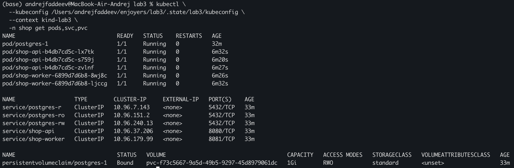
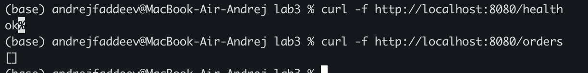
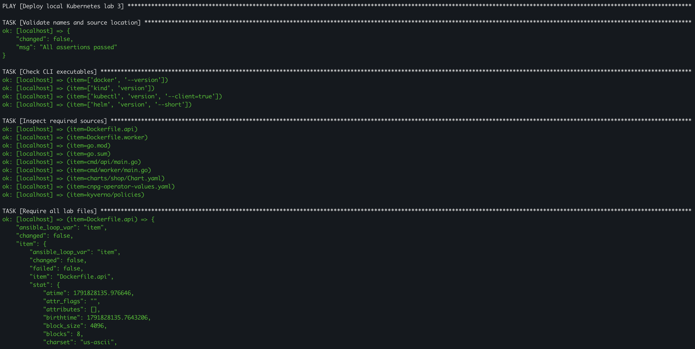
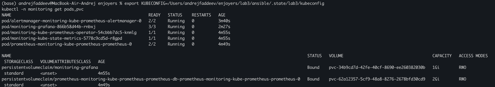
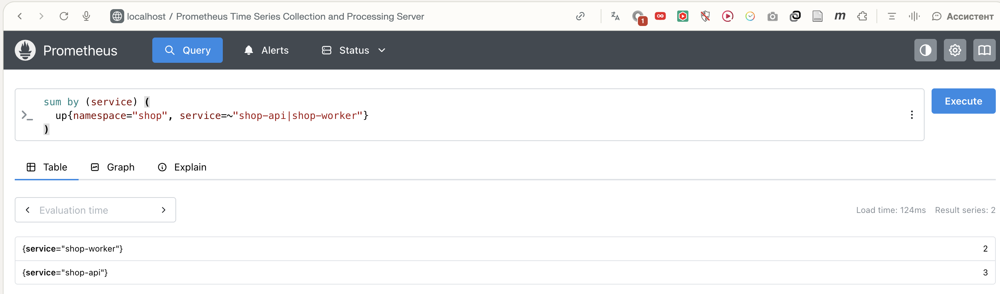
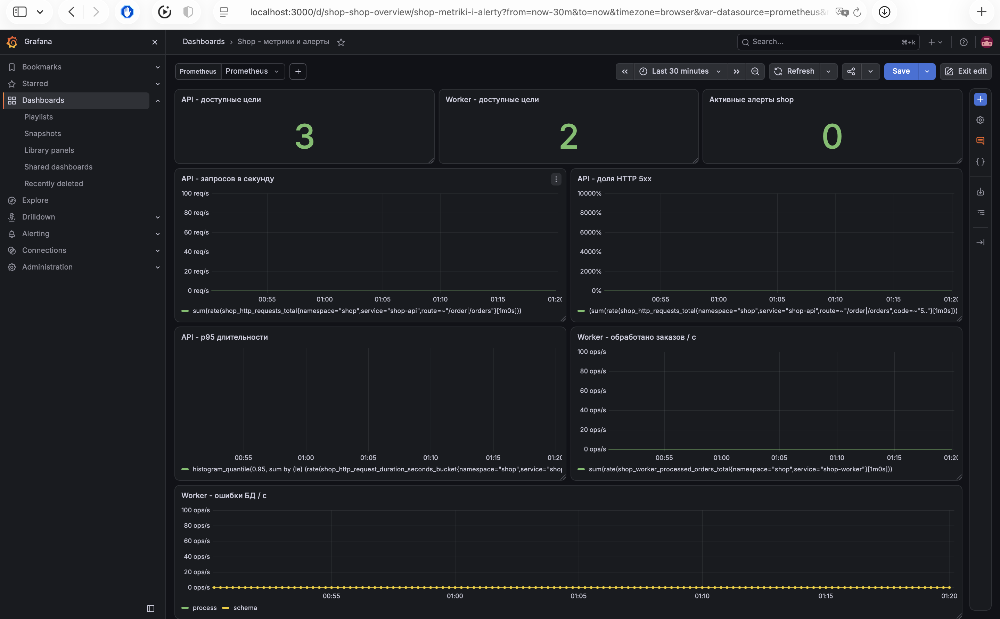
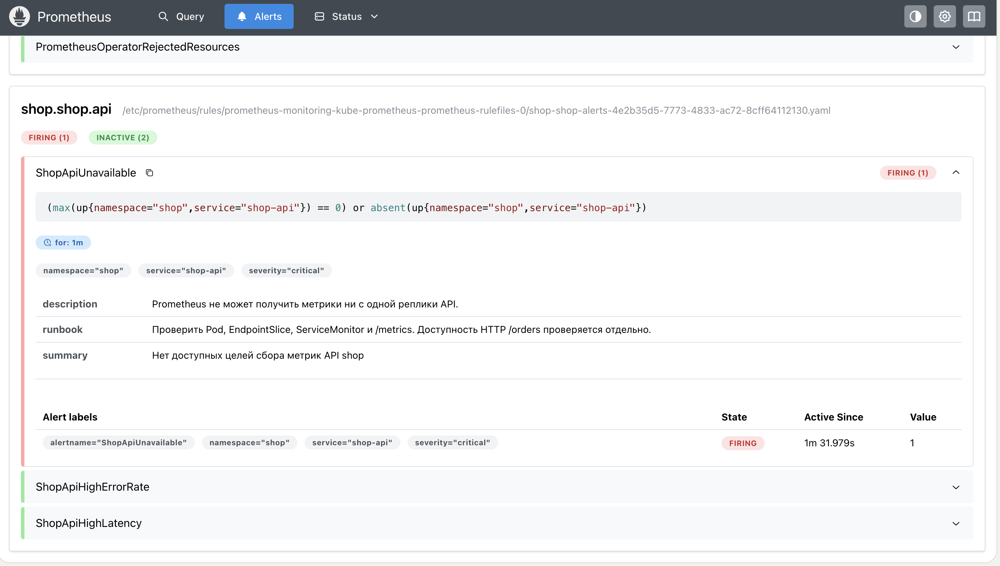
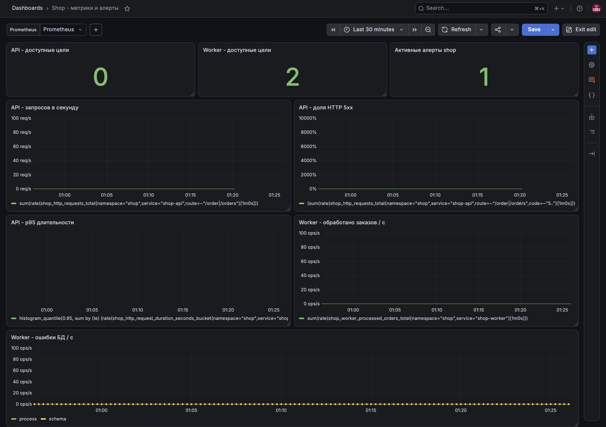

# Лабораторная работа 3

Задание: https://github.com/KeladKaal/containerization-and-orchestration/blob/main-rus/lecture-3-kubernetes-control-plane/lab.md

## Часть 0. API и worker на Go

Для API и worker выбрал Go. API предоставляет проверки `/health`, создание заказов через `POST /order` и чтение списка через `GET /orders`. Worker забирает необработанные заказы из PostgreSQL и отмечает их обработанными. Для обоих сервисов подготовлены Dockerfile.

## Часть 1. Политики Kyverno

Для проверок выбрал Kyverno: его правила можно хранить рядом с проектом в YAML и применять стандартным `kubectl`. Создал пять политик: обязательные CPU и memory requests/limits, разрешённый реестр `ghcr.io`, обязательные метки приложения, запрет privileged-контейнеров и требование запускаться не от root.

Каждое правило закрывает отдельный риск:

- **CPU и memory requests/limits.** Requests помогают планировщику учитывать потребление Pod, а limits ограничивают ресурсы контейнера.
- **Доверенный реестр `ghcr.io`.** Ограничение уменьшает вероятность запуска случайного или неподконтрольного образа.
- **Обязательные метки приложения.** Метки `app.kubernetes.io/name` и `app.kubernetes.io/part-of` помогают определить владельца ресурса и группировать объекты.
- **Запрет privileged-контейнеров.** Такой режим даёт контейнеру расширенный доступ к возможностям узла.
- **Запуск не от root.** `runAsNonRoot` уменьшает права процесса внутри контейнера и не позволяет запускать его с ненужными привилегиями суперпользователя.

После установки контроллеры Kyverno перешли в `Running`, а все пять `ClusterPolicy` получили `READY=True`.

Проверка нарушающих манифестов прошла ожидаемо: API server отклонил каждый из пяти Pod. 

Позже выяснилось, что глобальные запреты затрагивают не только приложение. Когда CloudNativePG попросил local-path provisioner создать служебный helper Pod, Kyverno его заблокировал. В результате PVC PostgreSQL долго оставался `Pending`. Добавили исключение для namespace `local-path-storage`; это позволило provisioner-у создать том. Выяснли, что политика кластера должна учитывать системные компоненты, иначе ограничение может остановить инфраструктуру, на которую опирается приложение. 

На ошибках учатся, как говорится :)

## Часть 2. Helm-чарт и обновления

API и worker оформлены как Deployment и ClusterIP Service в `charts/shop`. Число реплик задаётся через `values.yaml`: изначально три API Pod и два worker Pod. В шаблонах учтены требования Kyverno, а для API настроено обновление с `maxUnavailable: 0` и `maxSurge: 1`.

API был Ready 3/3, worker - 2/2. 

Удалили Api Pod вручную - Deployment создал замену.

Затем изменил число реплик на +1 - количество подов увеличилось.

При настоящем rolling update сменили тег образа API. `/health` все полученные ответы были `200`. Новый ReplicaSet обновил три реплики, причём Pod появлялись в разное время, это доказывается различным значением `AGE`. 

Один из подов живет дольше остальных, потому что он был создан при одной из неудачных попыток :)

Отдельно проверили невалидную версию. Она установлена не была

Во время отдельной попытки upgrade новая версия не смогла загрузиться (`ImagePullBackOff`), а ожидание Helm завершилось неудачей/таймаутом. После `helm rollback` предыдущая ревизия была применена повторно: `kubectl rollout status deployment/shop-api` завершился успешно, API снова имел 3/3 Ready. История Helm при этом сохранила неудачную ревизию и добавила новую ревизию отката. Иными словами, rollback вернул прежнюю конфигурацию, а не исправил недоступный образ.

## Часть 3. PostgreSQL под управлением CloudNativePG

Для бд установили CloudNativePG в отдельный namespace `cnpg-system`. 

Первый запуск базы застопорился на `Pending`. Диагностика PVC показала, что проблема не в нехватке диска и не в самом PostgreSQL: local-path provisioner пытался создать helper Pod, но Kyverno отклонял его сразу по нескольким правилам. После исключения служебного namespace из политик PVC перешёл в `Bound`, а Pod `postgres-1` стал Ready. `kubectl get cluster postgres` сообщил `Cluster in healthy state`.

Затем я вручную удалил PostgreSQL Pod. Сначала он долго был в `Terminating`, казалось, что всё зависло с ошибкой. Однако в дальнейшем под успешно удалился и заново поднялся.

`controller-manager` Kubernetes управляет встроенными общими ресурсами, например поддерживает число Pod у Deployment через ReplicaSet. Он не знает, как устроена PostgreSQL. CloudNativePG - отдельный оператор со своим CRD и знаниями о базе: он создаёт PostgreSQL-инстансы и связанные ресурсы, отслеживает состояние БД и восстанавливает удалённый Pod. Оба используют reconciliation - сверяют желаемое состояние с фактическим и приводят фактическое к желаемому, - но оператор применяет этот цикл к конкретной предметной области PostgreSQL.

## Часть 4. Что осталось работать без API server

Чтобы проверить отказ управляющего API, создали probe Pod в кластере. Он циклически обращался к `/health` API, `/orders` API и `/health` worker, а результаты записывал в логи. 

Затем временно убрали манифест static Pod `kube-apiserver` из каталога, за которым следит kubelet kind-ноды. Пока API server был выключен, `kubectl get nodes` и попытка изменить число реплик `shop-api`  сбросом соединения. После возврата манифеста команды Kubernetes снова заработали.

В логах probe, прочитанных после восстановления: проверки продолжали записывать `api-health=200 api-orders=200 worker-health=200`. У же запущенная нагрузка продолжила отвечать.

## Часть 5. Мониторинг

Можно добавить в отчёт отдельный подраздел **«Автоматизация развёртывания лабораторного окружения»**.

Для воспроизведения окружения третьей лабораторной работы был подготовлен Ansible playbook. Необходимость автоматизации возникла при переносе работы на локальный компьютер: наличие исходного кода и Helm chart в репозитории само по себе не обеспечивало готовое окружение. Требовалось создать Kubernetes-кластер, собрать образы приложений, установить операторы и применить политики в правильной последовательности. Автоматизация позволила описать этот порядок в файлах проекта и сократить количество ручных команд.

Playbook выполнялся локально, без подключения по SSH. Он проверял наличие необходимых инструментов и файлов, создавал kind-кластер при его отсутствии, собирал Docker-образы API и worker и загружал их непосредственно в кластер. Затем устанавливались Kyverno, пять политик безопасности и оператор CloudNativePG. После подготовки операторов разворачивался Helm chart `shop`, включавший приложения и объект PostgreSQL. Между зависимыми этапами выполнялось ожидание готовности ресурсов.

Для упрощения запуска был создан скрипт `run.sh`. Он создавал и активировал виртуальное окружение Python, устанавливал зависимости Ansible и коллекцию `kubernetes.core`, после чего запускал playbook. Настройки окружения были вынесены в отдельный файл. Повторный запуск позволял использовать существующий кластер и применять изменения приложений и Helm chart без ручного повторения всей последовательности.

После развёртывания была проверена готовность трёх подов API, двух подов worker и пода PostgreSQL. Том базы данных находился в состоянии `Bound`. Через `kubectl port-forward` был организован локальный доступ к API. Запрос `/health` вернул `ok`, а `/orders` - пустой JSON-массив `[]`. Эти результаты подтвердили доступность HTTP-сервиса и успешное чтение списка заказов из базы данных. Создание и обработка заказов worker этой проверкой не оценивались.

Подготовленный подход можно использовать в других лабораторных работах. Общие этапы - проверку инструментов, создание кластера, сборку образов и установку Helm-релизов - можно сохранить, а настройки и задачи конкретной лабораторной заменить или дополнить. Например, для работы с мониторингом можно добавить развёртывание стека по сохранённым конфигурациям, подключение источников метрик и проверку правил оповещения.

Для автоматизации были подготовлены основной playbook, файлы задач, настройки окружения, inventory и скрипт запуска. Такая структура позволила разделить подготовку кластера, сборку приложений, установку компонентов и проверку результата. Отдельные Ansible-роли не создавались: задачи были сгруппированы в тематические файлы каталога `tasks`.

В файле `playbook.yml` была определена последовательность развёртывания. Выполнение было настроено для группы `local`, а параметры окружения были подключены из `settings.yml`. Через `module_defaults` были заданы общий kubeconfig, Kubernetes-контекст и параметры ожидания для модулей коллекции `kubernetes.core`. Для защиты от одновременных запусков было предусмотрено создание каталога блокировки `run.lock`. Задача его удаления была размещена в секции `always`, чтобы блокировка снималась и при возникновении ошибки.

Назначение файлов задач представлено в таблице.

| Файл | Реализованные действия |
|---|---|
| `tasks/preflight.yml` | Была предусмотрена проверка параметров, наличия Docker, kind, kubectl и Helm, исходных файлов и пяти политик. Проверка chart была реализована командами `helm lint` и `helm template`. Для отдельного запуска этапу был назначен тег `preflight`. |
| `tasks/cluster.yml` | Были реализованы получение списка kind-кластеров, создание отсутствующего кластера, сохранение отдельного kubeconfig и имени образа ноды, ожидание состояния `Ready`. |
| `tasks/image.yml` | Были реализованы сборка образов API и worker с использованием Docker-кэша, получение идентификаторов образов, формирование тегов и загрузка образов непосредственно в kind. Для обоих приложений был использован один набор задач, выполняемый в цикле. |
| `tasks/chart.yml` | Была реализована загрузка Helm chart Kyverno и CloudNativePG. Скачанные архивы были сохранены в локальном каталоге для повторного использования. |
| `tasks/deploy.yml` | Были описаны установка и обновление Kyverno, применение политик, установка CloudNativePG и развёртывание `shop`. Перед зависимыми действиями было предусмотрено ожидание готовности CRD и политик. |
| `tasks/verify.yml` | Были реализованы ожидание готовности PostgreSQL, проверка завершения rollout API и worker, вывод состояния Pod, Service и PVC. Дополнительно была предусмотрена выдача команды для последующей HTTP-проверки. |

В `settings.yml` были вынесены изменяемые параметры: путь к исходникам, имя кластера, namespace приложения, расположение служебных файлов, время ожидания, версии чартов операторов и префикс имён образов. Благодаря этому настройки развёртывания могли быть изменены без редактирования самих задач.

В `inventory.ini` был указан `localhost` с параметром `ansible_connection=local`. Выполнение было организовано на локальной машине без подключения по SSH. В `ansible.cfg` были заданы путь к inventory, локальный каталог коллекций и каталог временных файлов Ansible.

Зависимости были описаны в нескольких файлах. В `requirements.txt` был приведён перечень основных Python-пакетов, а в `requirements-lock.txt` были зафиксированы конкретные версии зависимостей. В `requirements.yml` была указана коллекция `kubernetes.core`. В скрипте `run.sh` были предусмотрены создание и активация виртуального окружения `.venv`, установка зависимостей и запуск playbook с переданными аргументами.

Для управления Helm-релизами был использован модуль `kubernetes.core.helm`, для применения политик - `kubernetes.core.k8s`, для получения состояния PostgreSQL - `kubernetes.core.k8s_info`. Операции kind, сборка Docker-образов и отдельные проверки были реализованы через `ansible.builtin.command`. Для сохранения результатов команд был использован параметр `register`, для задания условий выполнения - `when`, для хранения вычисленных значений - `set_fact`.

Для повторного развёртывания был предусмотрен учёт изменений приложений и конфигурации. Теги образов были сформированы на основе их идентификаторов, поэтому изменение собранного образа отражалось в параметрах Deployment. Дополнительно была реализована проверка изменений chart: контрольная сумма его файлов была включена в Helm values, чтобы изменения шаблонов также учитывались при обновлении релиза.

В каталоге `.state` были сохранены служебные данные: отдельный kubeconfig, имя образа ноды и архивы чартов. Для kubeconfig были установлены права доступа `0600`. Сохранение содержимого PostgreSQL этим механизмом не обеспечивалось: для восстановления базы после утраты кластера требовалась отдельная резервная копия.

При дальнейшем расширении автоматизации подключаемые файлы задач могут быть преобразованы в Ansible-роли, например для подготовки kind, установки операторов и развёртывания приложения. В текущей реализации задачи были разделены на тематические файлы в пределах одного playbook.

На основе сохранённой конфигурации второй лабораторной работы в пространстве имён monitoring были развёрнуты Prometheus, Grafana и Alertmanager. Установка была включена в Ansible playbook. Для компонентов были заданы ресурсы, обязательные метки и параметры запуска без прав root. В политике источников образов был предусмотрен отдельный список разрешённых образов мониторинга. Остальные проверки Kyverno были сохранены. Готовность компонентов и подключение постоянных томов были подтверждены, HTTP-проверки вернули код 200.

В API и worker были добавлены HTTP-обработчики /metrics. Для API были реализованы счётчик запросов и гистограмма длительности обработки, для worker - счётчики обработанных заказов и ошибок обращения к базе данных. В Helm chart были добавлены два ресурса ServiceMonitor. Сбор метрик был настроен с интервалом 15 секунд. В Prometheus была подтверждена доступность трёх реплик API и двух реплик worker.

Далее, в Helm chart были добавлены дашборд Grafana и ресурс PrometheusRule с тремя правилами оповещения. Были предусмотрены проверки недоступности API, высокой доли серверных ошибок и превышения допустимой задержки. Запросы /health были исключены из расчёта бизнес-метрик. Загрузка дашборда и корректность вычисления правил были проверены. На момент проверки все три оповещения находились в состоянии inactive. Изначально, для графаны был задан лимит по памяти в 256 Мб, из-за чего она перезапускалась из-за нехватки памяти OOMKilled, после расширения лимита до 1 Гб, проблема была решена.

Для каждого правила было сформулировано обоснование выбора:

| Правило | Условие срабатывания | Обоснование |
| --- | --- | --- |
| `ShopApiUnavailable` | Отсутствие успешного сбора метрик со всех реплик API либо отсутствие серий `up` в течение 1 минуты | Правило было добавлено для обнаружения потери всех доступных целей API, в том числе при исчезновении endpoints. Выдержка в 1 минуту была предусмотрена для исключения реакции на кратковременные сбои. Проверяется доступность сбора метрик; работоспособность бизнес-операций этим правилом отдельно не подтверждается. |
| `ShopApiHighErrorRate` | Доля ответов HTTP 5xx по `/order` и `/orders` превышает 10% за окно 2 минуты при минимум 20 запросах; условие сохраняется 2 минуты | Правило было добавлено для обнаружения ошибок операций с заказами, например при недоступности PostgreSQL. Такая проблема может возникнуть даже при успешных ответах `/health`. |
| `ShopApiHighLatency` | 95-й перцентиль длительности запросов к `/order` и `/orders` превышает 1 секунду за окно 2 минуты при минимум 20 запросах; условие сохраняется 2 минуты | Правило было добавлено для обнаружения замедления приложения до полного отказа. Был использован p95, чтобы учитывать медленные запросы, которые могут быть скрыты средним временем ответа. |

Для рабочей системы пороги должны определяться требованиями к сервису и наблюдаемой нагрузкой. Минимум 20 запросов был предусмотрен для снижения влияния единичных обращений. Выдержка `for` была задана для срабатывания при устойчивом нарушении условия. Запросы `/health` были исключены, чтобы успешные проверки работоспособности не снижали видимую долю ошибок операций с заказами. Метрики ошибок и задержек были объединены по всем репликам API.

Для проверки оповещения число реплик API было временно уменьшено до нуля. После исчезновения доступных целей сбора метрик и выдержки заданного интервала правило ShopApiUnavailable перешло в состояние Firing. Затем число реплик было восстановлено до трёх. После возобновления сбора метрик оповещение вернулось в состояние Inactive

В ходе выполнения пятой части был восстановлен стек мониторинга на основе конфигурации второй лабораторной работы. В API и worker были добавлены метрики, а в Helm chart - ресурсы ServiceMonitor, PrometheusRule и ConfigMap дашборда Grafana. Были настроены три оповещения: отсутствие доступных целей API, высокая доля серверных ошибок и превышение допустимой задержки. Срабатывание ShopApiUnavailable было проверено временным уменьшением числа реплик API до нуля. После фиксации состояния Firing число реплик было восстановлено до трёх, а оповещение вернулось в состояние Inactive.

## Итог

В ходе лабораторной собрали и развернули `shop` в локальном kind-кластере, проверил блокировку небезопасных Pod, изменение реплик и обновление приложения, подключил PostgreSQL через оператора и проверил работу сервисов при недоступном Kubernetes API. Самая неожиданная проблема возникла на стыке Kyverno и local-path provisioner-а: политики, задуманные для workload, заблокировали служебный Pod хранилища. Был настроен мониторинг, В API и worker были добавлены метрики, а в Helm chart - ресурсы ServiceMonitor, PrometheusRule и ConfigMap дашборда Grafana. Были настроены три оповещения: отсутствие доступных целей API, высокая доля серверных ошибок и превышение допустимой задержки. Срабатывание ShopApiUnavailable было проверено временным уменьшением числа реплик API до нуля. После фиксации состояния Firing число реплик было восстановлено до трёх, а оповещение вернулось в состояние Inactive.

