# Лабораторная работа 3

Задание: https://github.com/KeladKaal/containerization-and-orchestration/blob/main-rus/lecture-3-kubernetes-control-plane/lab.md

## Часть 0. API и worker на Go

Для API и worker выбрал Go. API предоставляет проверки `/health`, создание заказов через `POST /order` и чтение списка через `GET /orders`. Worker забирает необработанные заказы из PostgreSQL и отмечает их обработанными. Для обоих сервисов подготовлены Dockerfile.

## Часть 1. Политики Kyverno

Для проверок выбрал Kyverno: его правила можно хранить рядом с проектом в YAML и применять стандартным `kubectl`. Создал пять политик: обязательные CPU и memory requests/limits, разрешённый реестр `ghcr.io`, обязательные метки приложения, запрет privileged-контейнеров и требование запускаться не от root.

Каждое правило закрывает отдельный риск:

- **CPU и memory requests/limits.** Requests помогают планировщику учитывать потребление Pod, а limits ограничивают ресурсы контейнера.
- **Доверенный реестр `ghcr.io`.** Ограничение уменьшает вероятность запуска случайного или неподконтрольного образа.
- **Обязательные метки приложения.** Метки `app.kubernetes.io/name` и `app.kubernetes.io/part-of` помогают определить владельца ресурса и группировать объекты.
- **Запрет privileged-контейнеров.** Такой режим даёт контейнеру расширенный доступ к возможностям узла.
- **Запуск не от root.** `runAsNonRoot` уменьшает права процесса внутри контейнера и не позволяет запускать его с ненужными привилегиями суперпользователя.

После установки контроллеры Kyverno перешли в `Running`, а все пять `ClusterPolicy` получили `READY=True`.

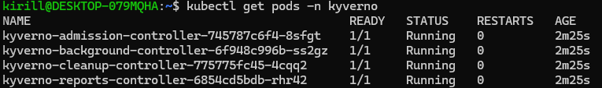
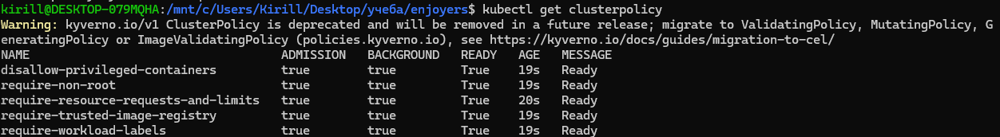

Проверка нарушающих манифестов прошла ожидаемо: API server отклонил каждый из пяти Pod. 

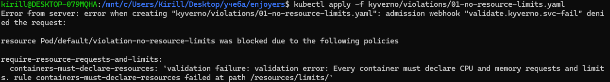
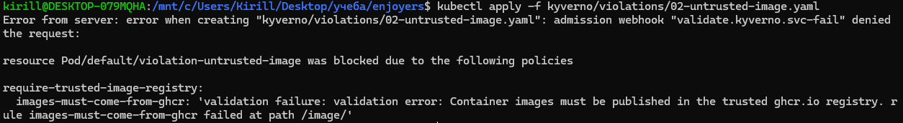
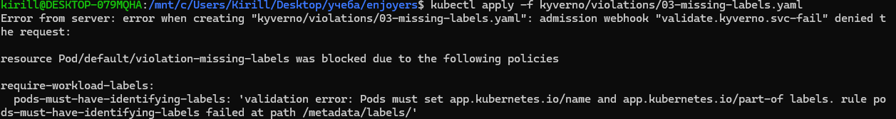
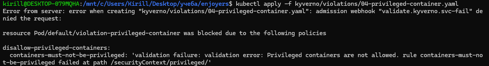
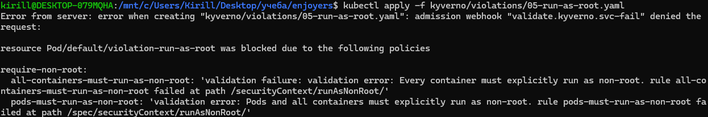

Позже выяснилось, что глобальные запреты затрагивают не только приложение. Когда CloudNativePG попросил local-path provisioner создать служебный helper Pod, Kyverno его заблокировал. В результате PVC PostgreSQL долго оставался `Pending`. Добавили исключение для namespace `local-path-storage`; это позволило provisioner-у создать том. Выяснли, что политика кластера должна учитывать системные компоненты, иначе ограничение может остановить инфраструктуру, на которую опирается приложение. 

На ошибках учатся, как говорится :)

## Часть 2. Helm-чарт и обновления

API и worker оформлены как Deployment и ClusterIP Service в `charts/shop`. Число реплик задаётся через `values.yaml`: изначально три API Pod и два worker Pod. В шаблонах учтены требования Kyverno, а для API настроено обновление с `maxUnavailable: 0` и `maxSurge: 1`.

API был Ready 3/3, worker — 2/2. 

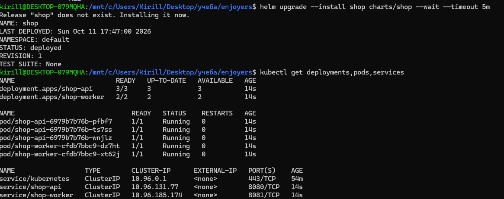

Удалили Api Pod вручную - Deployment создал замену.

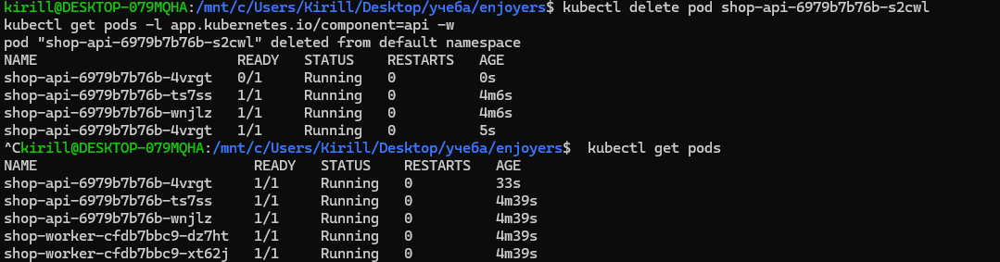

Затем изменил число реплик на +1 - количество подов увеличилось.

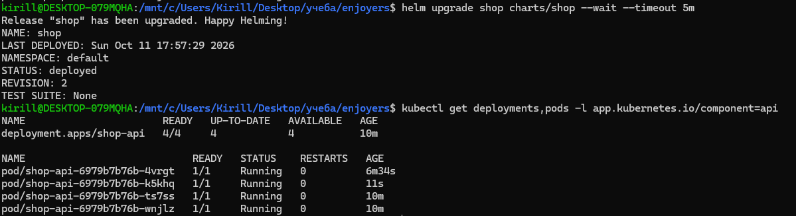

При настоящем rolling update сменили тег образа API. `/health` все полученные ответы были `200`. Новый ReplicaSet обновил три реплики, причём Pod появлялись в разное время, это доказывается различным значением `AGE`. 

Один из подов живет дольше остальных, потому что он был создан при одной из неудачных попыток :)

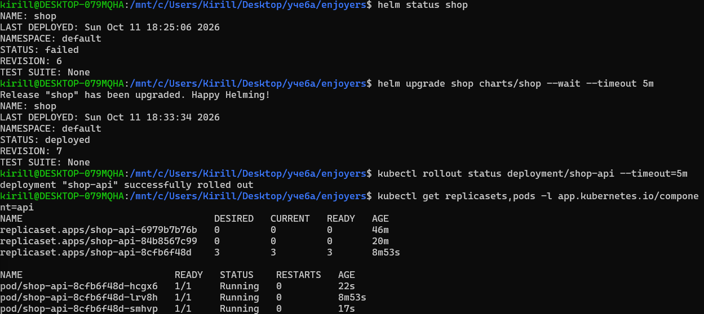

Отдельно проверили невалидную версию. Она установлена не была

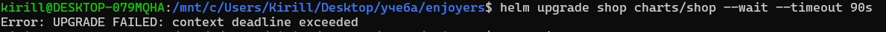
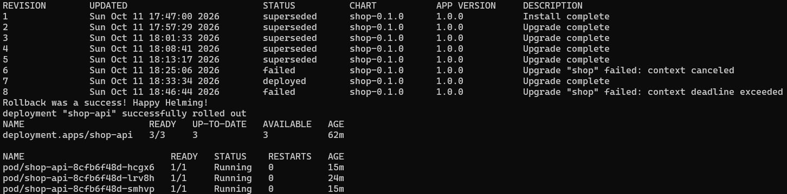

Во время отдельной попытки upgrade новая версия не смогла загрузиться (`ImagePullBackOff`), а ожидание Helm завершилось неудачей/таймаутом. После `helm rollback` предыдущая ревизия была применена повторно: `kubectl rollout status deployment/shop-api` завершился успешно, API снова имел 3/3 Ready. История Helm при этом сохранила неудачную ревизию и добавила новую ревизию отката. Иными словами, rollback вернул прежнюю конфигурацию, а не исправил недоступный образ.

## Часть 3. PostgreSQL под управлением CloudNativePG

Для бд установили CloudNativePG в отдельный namespace `cnpg-system`. 

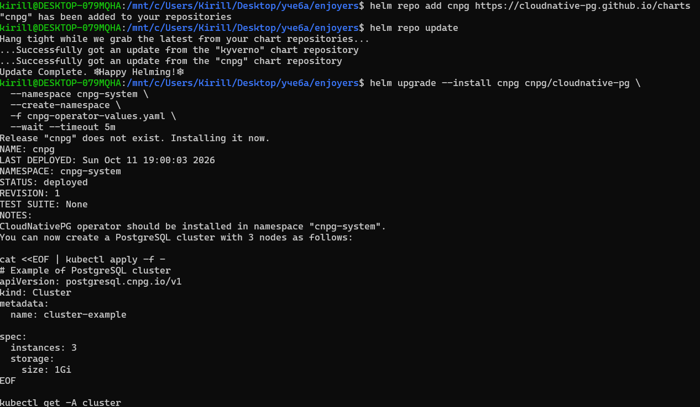
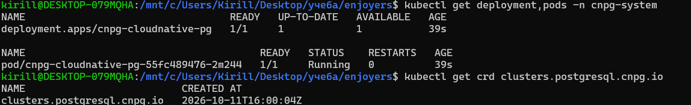

Первый запуск базы застопорился на `Pending`. Диагностика PVC показала, что проблема не в нехватке диска и не в самом PostgreSQL: local-path provisioner пытался создать helper Pod, но Kyverno отклонял его сразу по нескольким правилам. После исключения служебного namespace из политик PVC перешёл в `Bound`, а Pod `postgres-1` стал Ready. `kubectl get cluster postgres` сообщил `Cluster in healthy state`.

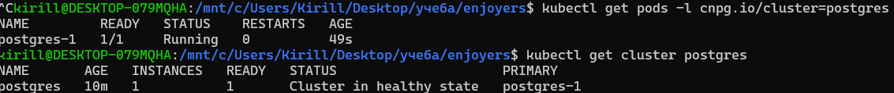

Затем я вручную удалил PostgreSQL Pod. Сначала он долго был в `Terminating`, казалось, что всё зависло с ошибкой. Однако в дальнейшем под успешно удалился и заново поднялся.

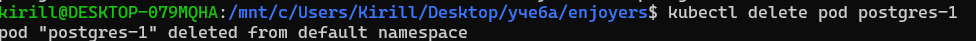
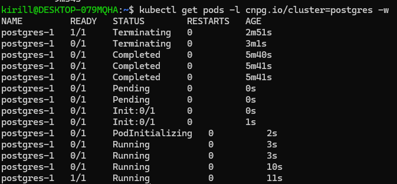

`controller-manager` Kubernetes управляет встроенными общими ресурсами, например поддерживает число Pod у Deployment через ReplicaSet. Он не знает, как устроена PostgreSQL. CloudNativePG — отдельный оператор со своим CRD и знаниями о базе: он создаёт PostgreSQL-инстансы и связанные ресурсы, отслеживает состояние БД и восстанавливает удалённый Pod. Оба используют reconciliation — сверяют желаемое состояние с фактическим и приводят фактическое к желаемому, — но оператор применяет этот цикл к конкретной предметной области PostgreSQL.

## Часть 4. Что осталось работать без API server

Чтобы проверить отказ управляющего API, создали probe Pod в кластере. Он циклически обращался к `/health` API, `/orders` API и `/health` worker, а результаты записывал в логи. 

Затем временно убрали манифест static Pod `kube-apiserver` из каталога, за которым следит kubelet kind-ноды. Пока API server был выключен, `kubectl get nodes` и попытка изменить число реплик `shop-api`  сбросом соединения. После возврата манифеста команды Kubernetes снова заработали.

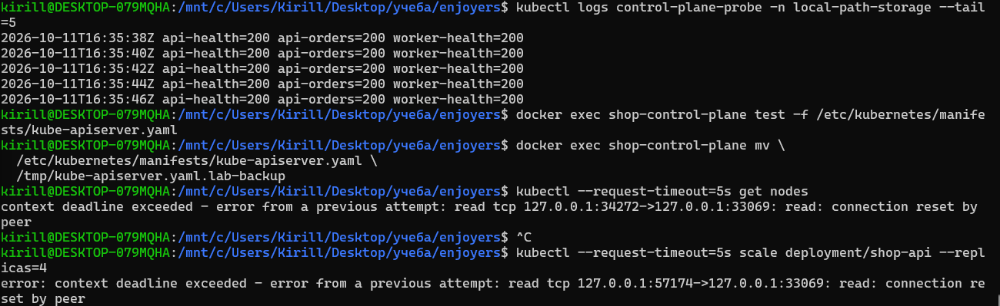
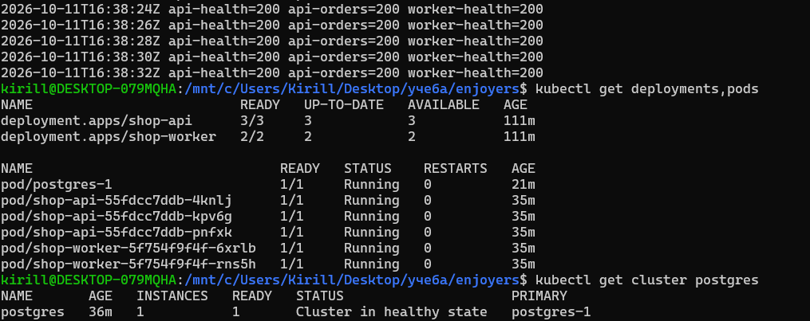

В логах probe, прочитанных после восстановления: проверки продолжали записывать `api-health=200 api-orders=200 worker-health=200`. У же запущенная нагрузка продолжила отвечать.

## Часть 5. Мониторинг

## Итог

В ходе лабораторной собрали и развернули `shop` в локальном kind-кластере, проверил блокировку небезопасных Pod, изменение реплик и обновление приложения, подключил PostgreSQL через оператора и проверил работу сервисов при недоступном Kubernetes API. Самая неожиданная проблема возникла на стыке Kyverno и local-path provisioner-а: политики, задуманные для workload, заблокировали служебный Pod хранилища. 

