# Отчёт по лабораторной работе 4

## Часть 0 - Сервис batch

Для фоновой нагрузки подготовлен небольшой контейнер на Go.

При старте программа выделяет 128 Мб памяти и удерживает их, а затем постоянно выполняет вычисления, нагружая CPU.

[Код](./batch/main.go)

## Часть 1 - Механизм разнесения

Сравнение механизмов:

- `podAntiAffinity` говорит планировщику: старайся не ставить похожие Pod на один узел. Если задать это требование жёстко, Pod может остаться в `Pending` - состоянии ожидания - когда свободного узла нет.
- `topologySpreadConstraints` говорит планировщику: распределяй выбранные Pod между узлами как можно равномернее.

### Почему выбран `topologySpreadConstraints`

В этой лабораторной ресурсов намеренно будет не хватать. Поэтому я выбрал балансировку, а не жёсткий запрет. Например, если есть два узла и три реплики API, требование каждую реплику на отдельный узел здесь выполнить невозможно: узлов меньше, чем реплик.


В `values.yaml` параметр `api.spread.mode` выбирает один из двух механизмов.

```bash
  spread:
    mode: topologySpreadConstraints
    topologySpreadConstraints:
      maxSkew: 1
      topologyKey: kubernetes.io/hostname
      whenUnsatisfiable: ScheduleAnyway
    podAntiAffinity:
      topologyKey: kubernetes.io/hostname
      weight: 100
```

Шаблон `api-deployment.yaml` применяет только тот механизм, который выбран в `values.yaml`. Если указать другое значение, кроме этих двух вариантов, Helm сообщит об ошибке вместо того, чтобы незаметно создать Deployment без настройки размещения.

## Часть 2 - Тесная площадка

Для Лабы 4 создал отдельный кластер kind с двумя узлами: `lab4-control-plane` и `lab4-worker`.

В копию чарта `lab4/charts/shop` добавлен [batch-deployment.yaml](./charts/shop/templates/batch-deployment.yaml). Deployment запускает одну реплику фоновой нагрузки.

### Исходные requests и limits

У `batch` целевой буфер памяти - 128 Мб, поэтому для него выбран request 64Mi и limit 256Mi: узел резервирует небольшой объём под фоновую работу, а контейнеру оставлен запас, когда в системе есть свободная память. Лимит CPU `500m`

В пространстве имён cnpg-system с помощью Helm был установлен оператор CloudNativePG. Для него использовался файл настроек из лабораторной работы № 3. 


Далее, были собраны контейнерные образы сервисов api, worker и batch. Для api и worker использовались исходный код и Dockerfile из лабораторной работы № 3. Образы были загружены на оба узла кластера kind.


В кластер был установлен Kyverno и перенесены пять защитных политик из лабораторной работы № 3. Политики работали в режиме Enforce и распространялись на поды приложения, включая фоновый сервис batch


С помощью Helm в пространстве имён shop были развёрнуты сервисы API, worker, фоновый сервис batch и PostgreSQL под управлением CloudNativePG.


Для проверки критического пути приложения был отправлен запрос POST /order с тестовым заказом. API вернул код 201 Created. Последующий запрос GET /orders завершился с кодом 200 OK и вернул созданный заказ с тем же идентификатором.


Далее, в пространстве имён monitoring с помощью Helm был развёрнут стек kube-prometheus-stack версии 92.3.0. Использовались ранее подготовленные настройки мониторинга и ограничения безопасности.


Затем, в Helm chart shop был включён мониторинг. После обновления релиза были созданы объекты ServiceMonitor для API и worker.


## Часть 3 - Подбор ресурсов по метрикам и krr

Перед сбором данных под нагрузкой была проверена доступность метрик потребления ресурсов. В Prometheus были получены значения используемой памяти и средней загрузки CPU для контейнеров API, worker, batch и PostgreSQL. Эти данные необходимы для последующего анализа ресурсов с помощью krr.


Для накопления метрик потребления ресурсов был выполнен 15-минутный нагрузочный тест создания заказов. Целевая интенсивность составляла 30 запросов в секунду с распределением между тремя репликами API. Во время тестирования Prometheus собирал метрики контейнеров. Исходные настройки ресурсов и сводка нагрузочного теста были сохранены для последующего сравнения.


В ходе 15-минутного теста было отправлено 26 439 запросов, из которых 26 263 завершились созданием заказа, а 176 - ошибкой. Фактическая интенсивность составила 29,38 запроса в секунду. Значение p95 времени ответа составило 1,67 с. Генератор нагрузки пропустил 187 итераций, соответствующих 561 запланированному запросу. Полученные результаты зафиксированы как исходные показатели до настройки ресурсов.


Во время нагрузочного теста доля периодов ограничения CPU PostgreSQL достигала примерно 92%. У реплик API в тот же период существенного ограничения CPU не наблюдалось. Полученный результат указывает на CPU-лимит PostgreSQL как на возможный фактор увеличения задержек обработки заказов.

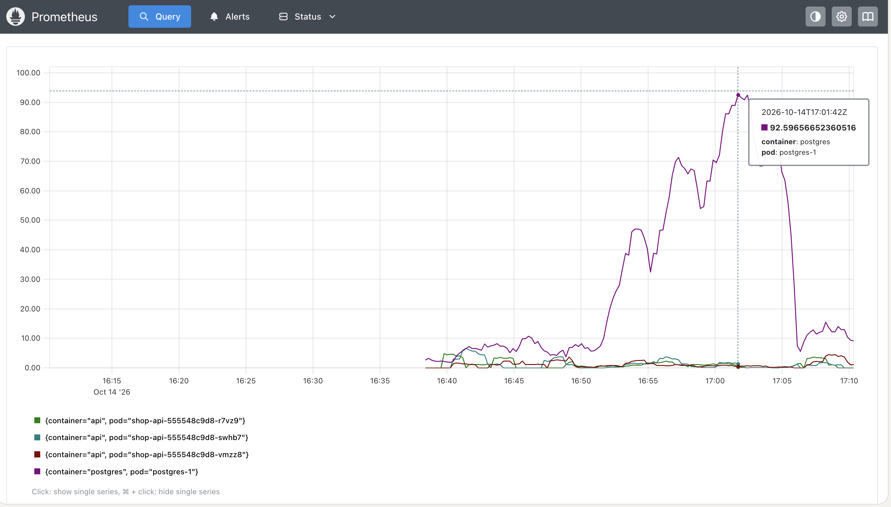
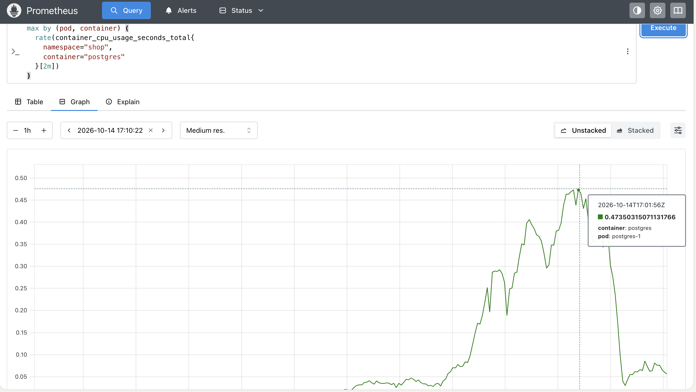

Был выполнен предварительный анализ ресурсов пространства имён shop с помощью krr. Для анализа запрашивалась история за последние 24 часа с шагом 15 секунд. Фактически использовались доступные измерения с момента запуска мониторинга. Результат был сохранён в файл reports/krr-initial.txt.

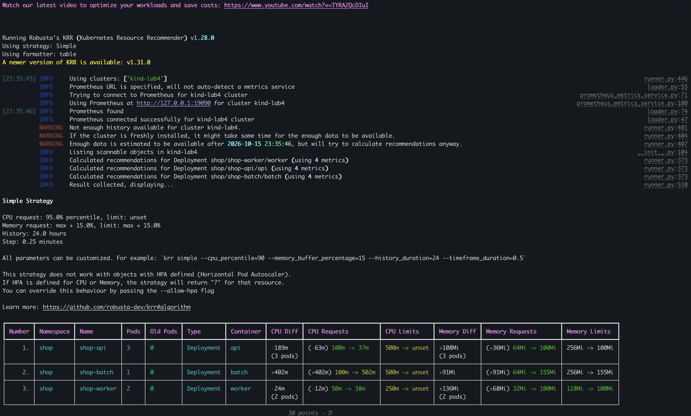

Krr v1.28.0 сформировал предварительные рекомендации для API, worker и batch, предупредив о неполной истории измерений. PostgreSQL под управлением CloudNativePG в результат анализа не вошёл. Поэтому подбор ресурсов критического пути на данном этапе не был завершён.

Для API были применены рекомендованные krr значения: 37m CPU и 100Mi памяти на контейнер. В соответствии с требованием лабораторной работы значения requests и limits были установлены равными. После обновления Helm-релиза поды API получили класс QoS Guaranteed. 

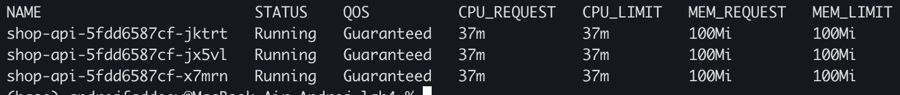

Для worker были применены рекомендации krr: CPU request 38m и request/limit памяти 100Mi. CPU limit был сохранён равным 250m, поскольку защитные политики требуют наличия лимитов. После обновления поды worker имели класс QoS Burstable.

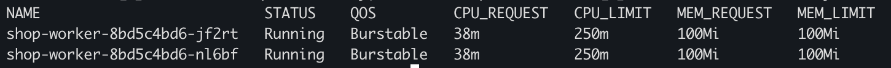

Для фонового сервиса batch были сохранены исходные ресурсы: CPU request 100m и limit 500m, memory request 64Mi и limit 256Mi. Контейнер имел класс QoS Burstable. Рекомендация krr увеличить резерв CPU не применялась, поскольку в эксперименте batch моделировал фоновую нагрузку с небольшим резервом и возможностью потреблять ресурсы сверх requests.

Повторный анализ krr охватывал последние 24 часа с шагом 15 секунд. Для API и worker были рекомендованы CPU requests 20m и память 100Mi. Для batch рекомендации составили 501m CPU и 1335Mi памяти; анализ включал предыдущие поды и периоды искусственно повышенного потребления. Для API были сохранены requests и limits CPU 100m, при которых успешно прошёл нагрузочный тест. Это значение являлось экспериментально проверенным отклонением от рекомендации krr. Для batch был сохранён небольшой резерв ресурсов согласно его роли фоновой нагрузки. Удаление CPU limits, предлагаемое стратегией krr, не применялось из-за требований защитных политик.

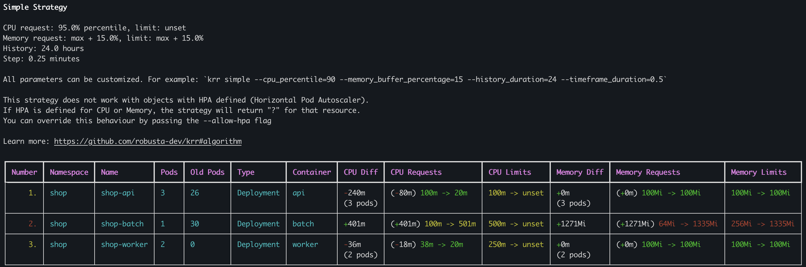

PostgreSQL был развёрнут под управлением оператора CloudNativePG. Его под принадлежал ресурсу Cluster API-группы postgresql.cnpg.io/v1, который не поддерживался механизмом обнаружения ресурсов в используемой версии krr 1.28.0. Поэтому PostgreSQL не вошёл в отчёт krr. Для PostgreSQL были сохранены CPU requests и limits 500m и memory requests и limits 512Mi. Эти значения использовались в успешном нагрузочном тесте, но не являлись рекомендациями krr.

Первоначально для API были заданы requests 100m CPU и 64Mi памяти, для worker - 50m и 32Mi, для batch - 100m и 64Mi, для PostgreSQL - 100m и 128Mi. После первого анализа krr requests API были изменены на 37m и 100Mi, worker - на 38m и 100Mi. В окончательной конфигурации API использовал requests и limits 100m и 100Mi, worker - requests 38m и 100Mi при limits 250m и 100Mi. Для batch были сохранены requests 100m и 64Mi при limits 500m и 256Mi; PostgreSQL получил равные requests и limits 500m и 512Mi.

Стратегия krr предлагала не задавать CPU limit. Это отличается от установки жёсткого CPU limit равным рекомендованному request. Итоговое значение 100m для API было проверено нагрузочным тестом, но сравнение запусков не доказывало, что улучшение было вызвано исключительно изменением CPU. Для worker были сохранены рекомендации первого анализа; повторная рекомендация 20m не применялась.

## Часть 4 - Разнесение API по узлам


В колонке `NODE` видно, что три реплики API распределены по двум узлам: одна на `lab4-control-plane`, две на `lab4-worker`.

Если один узел перестанет работать, на нём пропадут только размещённые там копии API. Копии на втором узле останутся запущенными и смогут продолжить отвечать на запросы. 

В нашем случае на одном узле находится одна реплика, на другом - две. Поэтому при отказе любого одного узла останется хотя бы одна копия API.

Разнесение API не обеспечивало отказоустойчивость всего критического пути: единственный экземпляр PostgreSQL находился на рабочем узле. Сохранение реплик API при отказе этого узла само по себе не гарантировало возможность создания заказов.

После уменьшения числа реплик API все оставшиеся поды оказались на одном узле. Для восстановления распределения параметр whenUnsatisfiable был изменён на DoNotSchedule при maxSkew=1. После обновления Helm-релиза три реплики API были распределены между двумя узлами в соотношении 2:1.

## Часть 5 - Приоритеты, QoS и PodDisruptionBudget

В Helm chart были добавлены два класса приоритета, параметры которых задавались через values.yaml. Класс lab4-shop-critical получил значение 10000 и разрешение вытеснять менее приоритетные поды. Класс lab4-shop-background получил значение −1000 и запрет инициировать вытеснение. Оба класса были созданы без назначения приоритетом по умолчанию.

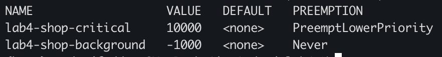

Через шаблоны Helm сервисам API и PostgreSQL был назначен класс lab4-shop-critical с приоритетом 10000, а фоновому сервису batch - lab4-shop-background с приоритетом −1000. Назначение было проверено по фактическим полям подов. Наблюдение вытеснения подов на данном этапе ещё не выполнялось.

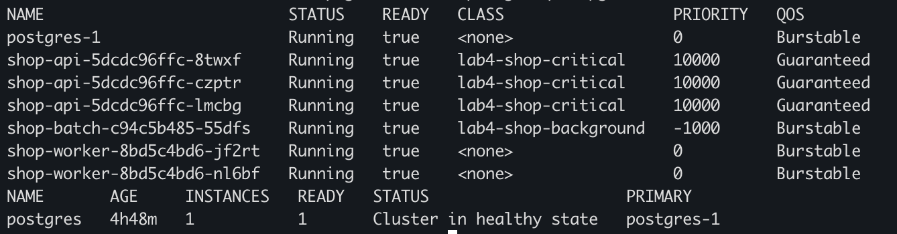

Сервисам API и PostgreSQL был назначен класс lab4-shop-critical с приоритетом 10000, а batch - lab4-shop-background с приоритетом −1000. Для применения настройки под PostgreSQL был пересоздан под управлением CloudNativePG с подключением существующего PVC. После восстановления под базы находился в состоянии Ready и имел приоритет 10000.

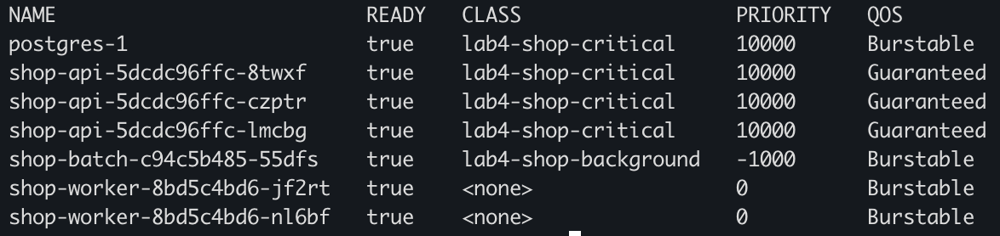

В Helm chart был добавлен PodDisruptionBudget для API с параметром minAvailable=2. При трёх здоровых репликах бюджет разрешал одно добровольное выселение через Eviction API. Параметры бюджета задавались в values.yaml.

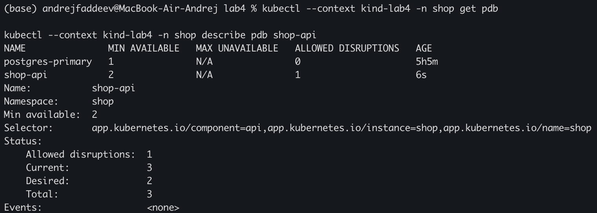

Управление PodDisruptionBudget PostgreSQL было явно включено через параметр values.yaml, передаваемый в ресурс Cluster CloudNativePG. Оператор поддерживал бюджет postgres-primary с minAvailable=1. При одном здоровом экземпляре базы разрешённое число добровольных выселений составляло ноль.

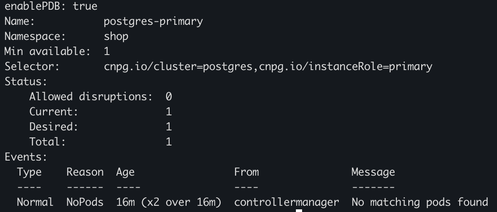

Для подготовки эксперимента с давлением памяти requests PostgreSQL были временно приравнены к существующим limits: 500m CPU и 512Mi памяти. Под получил класс QoS Guaranteed при сохранении приоритета 10000.

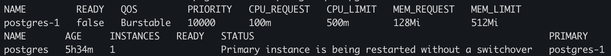

PriorityClass предоставлял критическим подам преимущество при планировании и возможность вытеснения менее приоритетных подов. Для API и PostgreSQL равные requests и limits CPU и памяти обеспечивали класс Guaranteed. Batch имел класс Burstable и низкий приоритет, а его потребление памяти превышало request. При давлении памяти учитываются превышение requests и приоритет пода; порядок выселения нельзя свести только к названию класса QoS. Guaranteed не обеспечивает абсолютной защиты от выселения.

PodDisruptionBudget ограничивал добровольные выселения через Eviction API, но не предотвращал выселение kubelet при давлении ресурсов и не защищал от отказа узла.

## Часть 6 - Дефицит ресурсов, Pending и preemption

Для демонстрации планирования по requests резерв памяти batch был временно увеличен до 2Gi на под при лимите 4Gi. Целевой объём буфера приложения оставался равным 128 мегабайт. После увеличения количества реплик до семи часть подов осталась Pending. События планировщика указывали на недостаток памяти для удовлетворения requests.

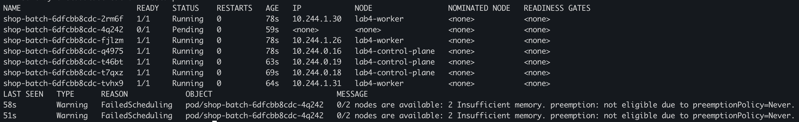

При заполнении узлов резервами batch количество реплик API было увеличено с 3 до 20 без изменения ресурсов одного контейнера. Для размещения более приоритетных подов API планировщик вытеснил менее приоритетные поды batch, что было подтверждено событиями Preempted. После увеличения количества реплик API с 3 до 20 планировщик вытеснил два низкоприоритетных пода batch на разных узлах. Вытеснение было подтверждено событиями Preempted. Все 20 реплик API достигли готовности, тогда как у batch работали пять из семи реплик, а две оставались Pending.

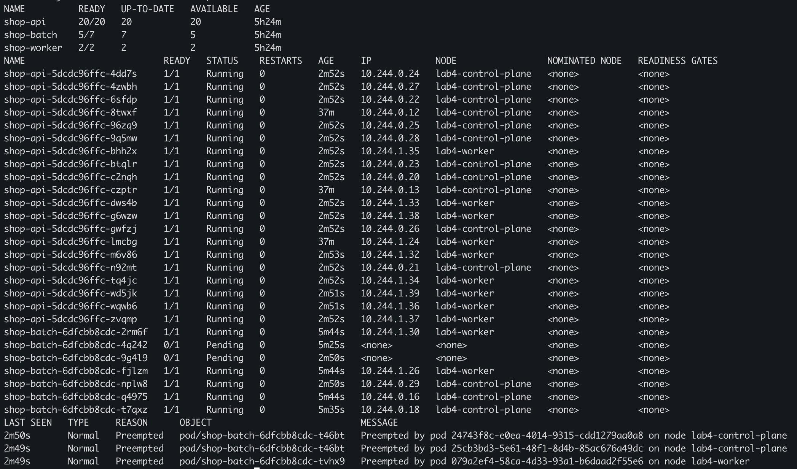

Планировщик учитывал сумму requests, а не фактическое потребление памяти подами. Поэтому batch мог оставаться Pending даже при небольшом реально используемом буфере. Отдельный нагрузочный тест обработки заказов во время preemption не был зафиксирован; данный эксперимент подтверждал вытеснение по приоритетам, но не выполнение SLA во время него.

## Часть 7 - Давление памяти и eviction

Первоначально порог evictionHard memory.available был установлен в 1Gi, а затем увеличен до 5500Mi. Приведённые ниже события выселения были получены после этого изменения. При первом выселении limit контейнера составлял 256Mi.

В исходной конфигурации kind порог выселения по памяти отсутствовал. На рабочем узле был задан порог evictionHard memory.available=1Gi. После перезапуска kubelet применение параметра было проверено через configz.

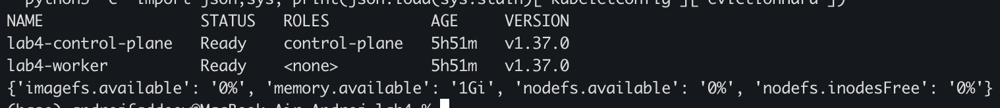

На рабочем узле было зафиксировано выселение фонового пода batch по причине недостатка доступной памяти. В момент события доступная память составляла около 5498 Мб при настроенном пороге 5500 Мб. Контейнер потреблял около 132 Мб при request 64 Мб и limit Мб Мб, имел класс QoS Burstable и приоритет −1000. Причина Evicted и сообщение kubelet подтвердили выселение вследствие давления памяти на узле, а не превышение собственного лимита контейнера. После восстановления Docker новый под batch находился на другом узле в состоянии Running.

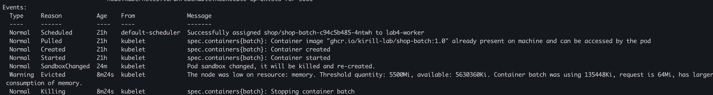

Для проведения эксперимента фоновый сервис batch был закреплён на узле lab4-worker с помощью nodeSelector. Настройка была задана через values.yaml и шаблон Helm. На этом узле ранее был установлен порог выселения по доступной памяти 5500 Мб.

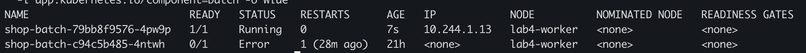

Через values.yaml объём буфера фонового сервиса batch был увеличен до 768 Мб, а лимит памяти - до 1 ГиБ при сохранении request 64 Мб. После обновления Helm-релиза kubelet выселил под batch с причиной Evicted. В момент выселения контейнер потреблял около 772,5 Мб, а доступная память узла составляла около 5421,1 Мб при пороге 5500 Мб. Таким образом, было зафиксировано выселение вследствие давления памяти на узле; потребление контейнера оставалось ниже его собственного лимита.

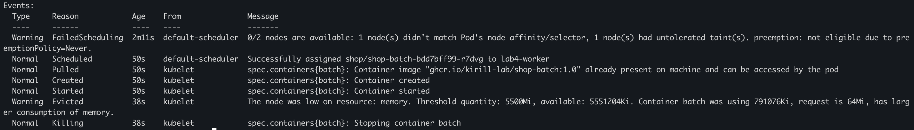

После эксперимента поды API, PostgreSQL и worker оставались готовыми. Их счётчики перезапусков относительно проверки перед увеличением нагрузки не изменились. Буфер batch был возвращён к 128 Мб, а лимит памяти - к 256 Мб. После снижения нагрузки условие MemoryPressure на рабочем узле перешло в False. Новый под batch, первоначально ожидавший размещения из-за taint узла, был автоматически назначен на lab4-worker и запущен.

## Часть 8 - Проверка SLA под нагрузкой

Для итогового пятиминутного теста при интенсивности 10 заказов в секунду были заданы условия: p95 менее 1 с, отсутствие ошибок создания заказов и пропущенных итераций генератора. Условие p95 относилось ко всему тесту, а не к каждому десятисекундному интервалу.

До создания перегрузки был проведён двухминутный тест с интенсивностью 10 заказов в секунду. Все 1200 запросов завершились успешно, пропущенных итераций не было. Значение p95 времени ответа составило 4,79 мс, максимальное время - 442,07 мс. Запросы направлялись через port-forward к одной реплике API.

Было обнаружено несоответствие внешнего ограничения памяти рабочего узла и объёма памяти, учитываемого kubelet. Лимит контейнера узла составлял 3 ГиБ, тогда как kubelet учитывал память виртуальной машины Docker. Внешний лимит был приведён к объёму памяти Docker без изменения ресурсов самой виртуальной машины.

При контрольном тестировании с интенсивностью 10 заказов в секунду все 297 отправленных запросов завершились успешно. Однако p95 времени ответа составило 1,15 с, а генератор пропустил четыре итерации. Установленные условия теста не были выполнены, поэтому подтверждение SLA потребовало дальнейшей диагностики.

При повторном минутном тесте с интенсивностью 10 заказов в секунду и 30 заранее подготовленными виртуальными пользователями были успешно обработаны 600 заказов. Пропущенные итерации отсутствовали. Значение p95 составило 30,73 мс, максимальное время ответа - 193,2 мс. Все заданные пороги теста были соблюдены.

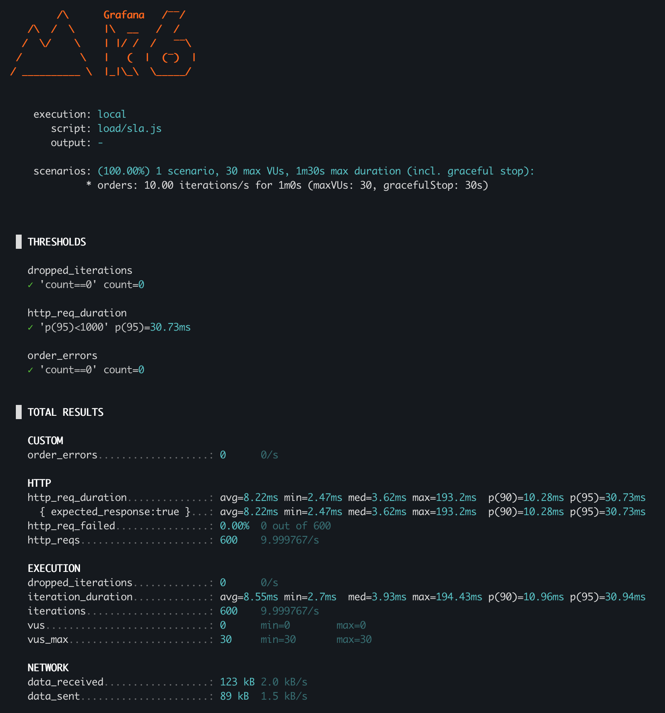

При нагрузочном тестировании с интенсивностью 10 заказов в секунду было зафиксировано выселение фонового пода batch из-за давления памяти. За пять минут было отправлено 2952 запроса, из которых 45 завершились ошибкой. Значение p95 составило 2,02 с; генератор пропустил 49 итераций. Заданные условия SLA не были выполнены.

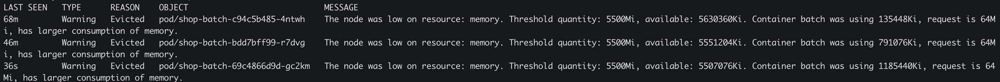

После увеличения CPU requests и limits API до 100m был проведён пятиминутный нагрузочный тест с интенсивностью 10 заказов в секунду. В 23:38:29, во время тестирования, kubelet выселил фоновый под batch из-за давления памяти на рабочем узле. Все 3000 запросов завершились успешно, пропущенные итерации отсутствовали. Значение p95 времени ответа за весь тест составило 287,06 мс при установленном пороге 1 с. Таким образом, заданные условия SLA были соблюдены в тесте, включавшем выселение фоновой нагрузки. Запросы направлялись через port-forward к одной реплике API.

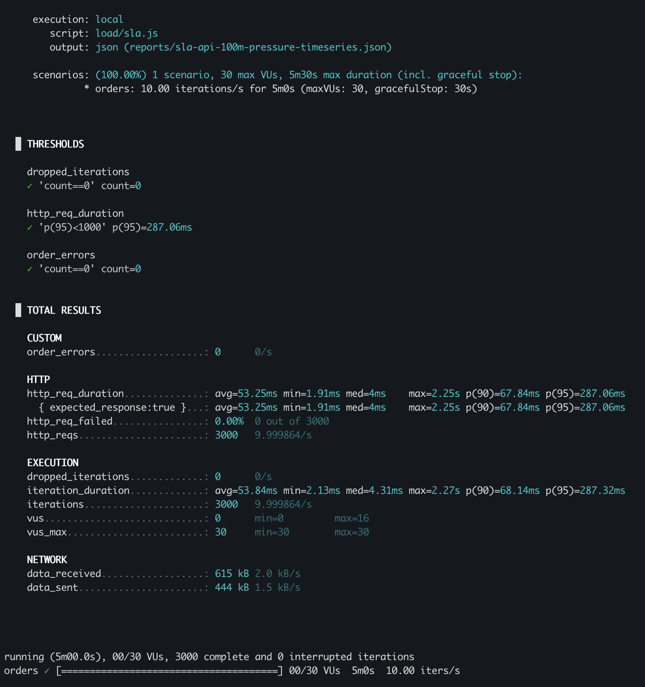

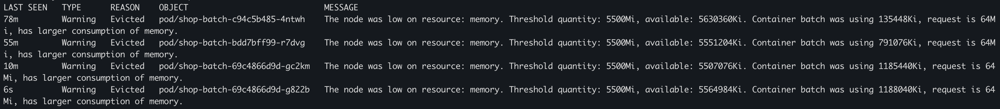

По временному ряду k6 были построены графики задержек и доли ошибок с группировкой по десятисекундным интервалам. Момент выселения batch отмечен вертикальной линией. Ошибки создания заказов отсутствовали во всех интервалах. Хотя в двух интервалах p95 превышал одну секунду, значение p95 за весь пятиминутный тест составило 287,07 мс и соответствовало установленному условию SLA.

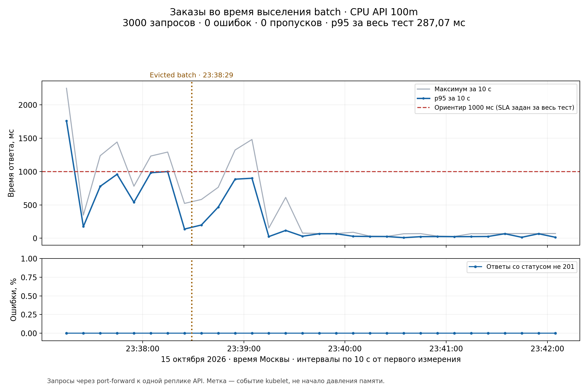

В итоговом эксперименте буфер batch был увеличен до 1152 МиБ при лимите памяти 1536Mi и request 64Mi. После эксперимента буфер был возвращён к 128 МиБ, а лимит - к 256Mi. По сохранённому временному ряду тест проходил 15 октября 2026 года с 23:37:09 до 23:42:09 по Москве; событие Evicted было зарегистрировано в 23:38:29 и попало внутрь этого интервала.

При округлении сохранённого значения 287,06905 мс до сотых p95 составило 287,07 мс; значение 287,06 мс выше было перенесено из краткого вывода терминала. Итоговые результаты сохранены в [сводке k6](reports/sla-api-100m-pressure-summary.json), [временном ряду](reports/sla-api-100m-pressure-timeseries.json) и [событиях выселения](reports/sla-api-100m-pressure-events.yaml).

## Часть 9 - Мониторинг и алерты

В Helm chart были включены ServiceMonitor для API и worker и объект PrometheusRule с тремя правилами оповещения. Правила контролировали доступность целей сбора метрик API, долю серверных ошибок и p95 времени бизнес-запросов. Для ошибок и задержек использовалось минимальное число запросов, исключавшее срабатывания по слишком малой выборке.

Для проверки оповещения число реплик API было временно уменьшено до нуля через values.yaml и обновление Helm-релиза. После исчезновения целей сбора метрик и истечения выдержки правило ShopApiUnavailable перешло в состояние Firing. Затем число реплик было восстановлено до трёх; после восстановления сбора метрик алерт вернулся в состояние Inactive.

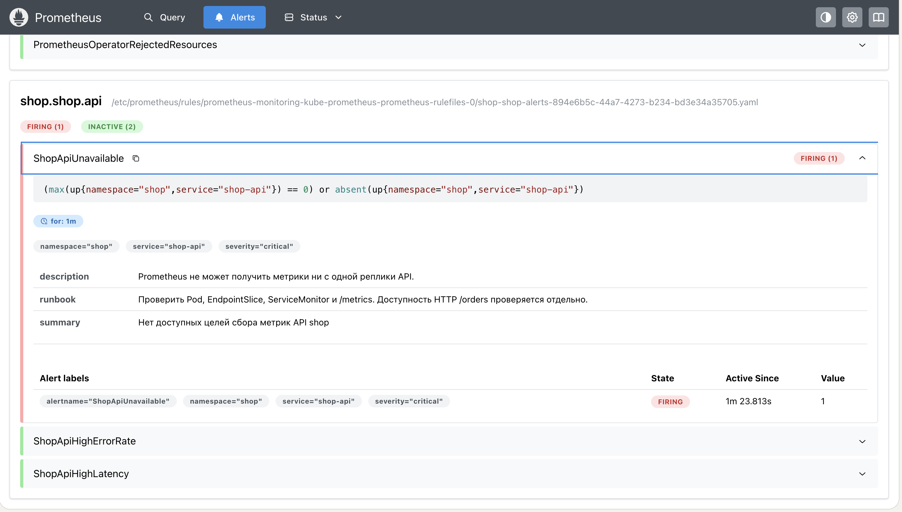

На дашборде Grafana за период 23:37–23:43 были отображены метрики успешного нагрузочного теста. В основной части теста интенсивность бизнес-запросов составляла около 10 запросов в секунду. Доля HTTP 5xx и частота ошибок обращения worker к базе данных оставались нулевыми. Оценка серверного p95 по гистограмме Prometheus достигала примерно 450 мс. Она рассчитывалась по временному окну и отличалась от клиентского p95 k6 за весь тест.

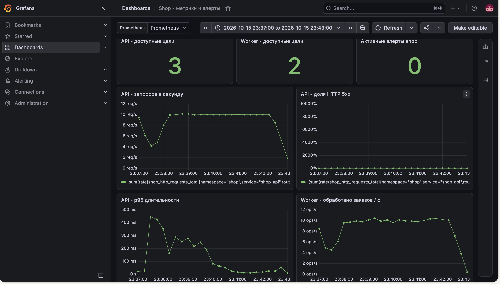

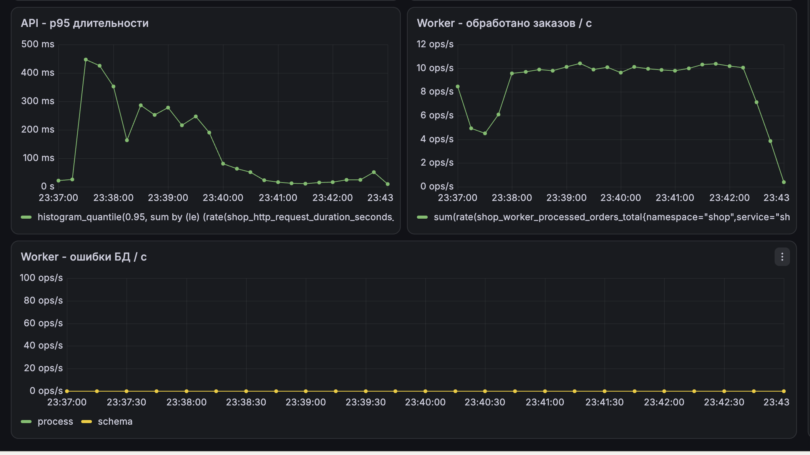

Правило ShopApiUnavailable выявляло отсутствие доступных целей сбора метрик API в течение одной минуты. Оно контролировало наблюдаемость API, а доступность бизнес-запросов проверялась отдельно.

Правило ShopApiHighErrorRate выявляло долю ответов HTTP 5xx выше 10% за окно две минуты при наличии не менее 20 бизнес-запросов. Для срабатывания нарушение должно было сохраняться две минуты. Правило предназначалось для обнаружения ошибок обработки заказов, в том числе при проблемах с базой данных.

Правило ShopApiHighLatency выявляло серверный p95 выше одной секунды за окно две минуты при наличии не менее 20 бизнес-запросов. Выдержка составляла две минуты. Правило предназначалось для обнаружения ухудшения времени обработки заказов. Оба правила учитывали маршруты /order и /orders, исключая health probes.

На сохранённом скриншоте панель HTTP 5xx имеет некорректный масштаб оси до 10000%, однако линия данных находится на нуле. Масштаб требует исправления в оформлении дашборда и не означает фактическую долю ошибок 10000%.

## Заключение

В работе были исследованы размещение подов, планирование по requests, вытеснение по приоритетам и выселение при давлении памяти. Реплики API были распределены между двумя узлами. Для критических компонентов были настроены приоритеты, класс Guaranteed и бюджеты добровольных прерываний. В пятиминутном тесте, включавшем выселение batch, успешно обработаны 3000 заказов, ошибки и пропущенные итерации отсутствовали, p95 составило 287,07 мс. Были проверены дашборд и срабатывание алерта недоступности целей API.

Ограничениями работы остались отсутствие рекомендаций krr для PostgreSQL под управлением CloudNativePG и отдельного измерения SLA во время preemption. Отклонение итоговых CPU requests API от рекомендаций krr было зафиксировано.
