# Отчёт по лабораторной работе 4

## Часть 0 — Сервис batch

Для фоновой нагрузки подготовлен небольшой контейнер на Go.

При старте программа выделяет 128 МиБ памяти и удерживает их, а затем постоянно выполняет вычисления, нагружая CPU.

[Код](./batch/main.go)

## Часть 1 — Механизм разнесения

Сравнение механизмов:

- `podAntiAffinity` говорит планировщику: старайся не ставить похожие Pod на один узел. Если задать это требование жёстко, Pod может остаться в `Pending` — состоянии ожидания — когда свободного узла нет.
- `topologySpreadConstraints` говорит планировщику: распределяй выбранные Pod между узлами как можно равномернее.

### Почему выбран `topologySpreadConstraints`

В этой лабораторной ресурсов намеренно будет не хватать. Поэтому я выбрал балансировку, а не жёсткий запрет. Например, если есть два узла и три реплики API, требование каждую реплику на отдельный узел здесь выполнить невозможно: узлов меньше, чем реплик.


В `values.yaml` параметр `api.spread.mode` выбирает один из двух механизмов.

```bash
  spread:
    mode: topologySpreadConstraints
    topologySpreadConstraints:
      maxSkew: 1
      topologyKey: kubernetes.io/hostname
      whenUnsatisfiable: ScheduleAnyway
    podAntiAffinity:
      topologyKey: kubernetes.io/hostname
      weight: 100
```

Шаблон `api-deployment.yaml` применяет только тот механизм, который выбран в `values.yaml`. Если указать другое значение, кроме этих двух вариантов, Helm сообщит об ошибке вместо того, чтобы незаметно создать Deployment без настройки размещения.

## Часть 2 — Тесная площадка

Для Лабы 4 создал отдельный кластер kind с двумя узлами: `lab4-control-plane` и `lab4-worker`.

В копию чарта `lab4/charts/shop` добавлен [batch-deployment.yaml](./charts/shop/templates/batch-deployment.yaml). Deployment запускает одну реплику фоновой нагрузки.

### Исходные requests и limits

У `batch` целевой буфер памяти — 128 МиБ, поэтому для него выбран request 64Mi и limit 256Mi: узел резервирует небольшой объём под фоновую работу, а контейнеру оставлен запас, когда в системе есть свободная память. Лимит CPU `500m` 

## Часть 4 — Разнесение API по узлам

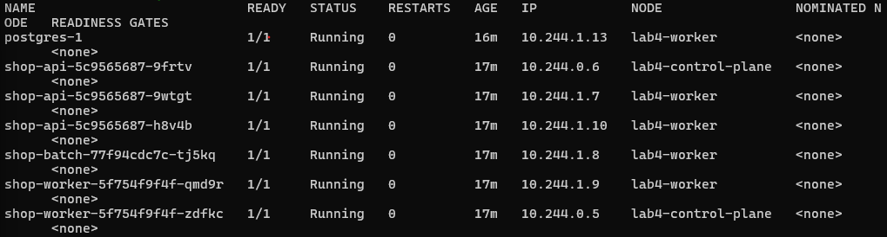

В колонке `NODE` видно, что три реплики API распределены по двум узлам: одна на `lab4-control-plane`, две на `lab4-worker`.

### Как это повышает отказоустойчивость

Если один узел перестанет работать, на нём пропадут только размещённые там копии API. Копии на втором узле останутся запущенными и смогут продолжить отвечать на запросы. 

В нашем случае на одном узле находится одна реплика, на другом — две. Поэтому при отказе любого одного узла останется хотя бы одна копия API.

В пространстве имён cnpg-system с помощью Helm был установлен оператор CloudNativePG. Для него использовался файл настроек из лабораторной работы № 3. 

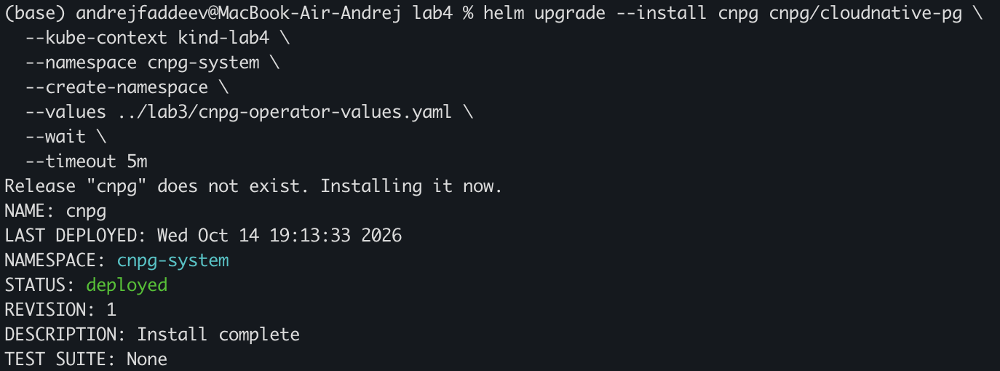

Далее, были собраны контейнерные образы сервисов api, worker и batch. Для api и worker использовались исходный код и Dockerfile из лабораторной работы № 3. Образы были загружены на оба узла кластера kind.

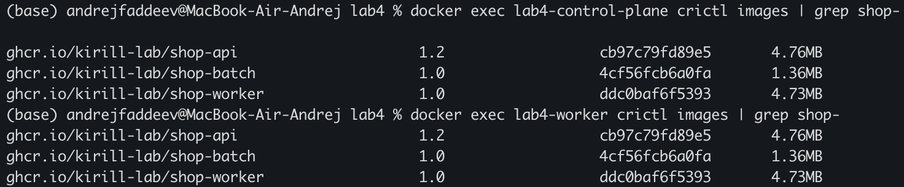

В кластер был установлен Kyverno и перенесены пять защитных политик из лабораторной работы № 3. Политики работали в режиме Enforce и распространялись на поды приложения, включая фоновый сервис batch

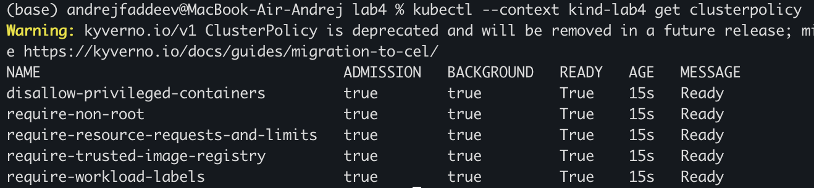

С помощью Helm в пространстве имён shop были развёрнуты сервисы API, worker, фоновый сервис batch и PostgreSQL под управлением CloudNativePG.

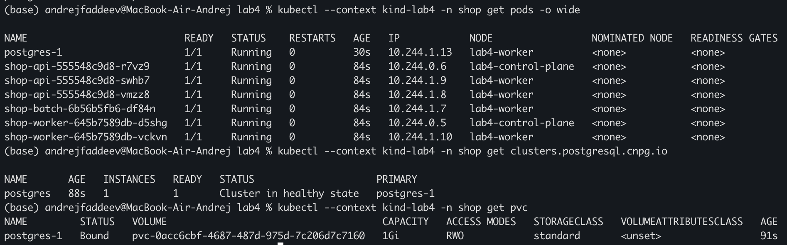

Для проверки критического пути приложения был отправлен запрос POST /order с тестовым заказом. API вернул код 201 Created. Последующий запрос GET /orders завершился с кодом 200 OK и вернул созданный заказ с тем же идентификатором.

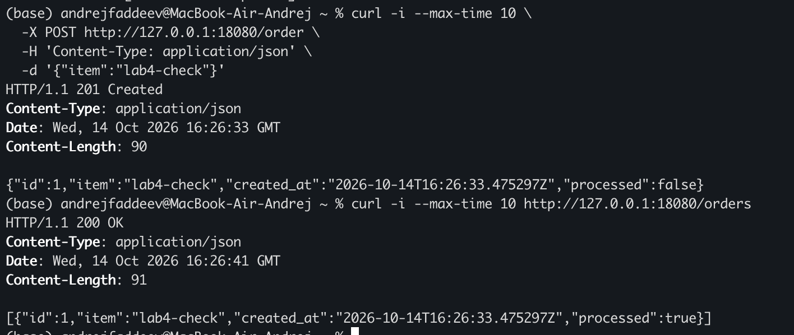

Далее, в пространстве имён monitoring с помощью Helm был развёрнут стек kube-prometheus-stack версии 92.3.0. Использовались ранее подготовленные настройки мониторинга и ограничения безопасности.

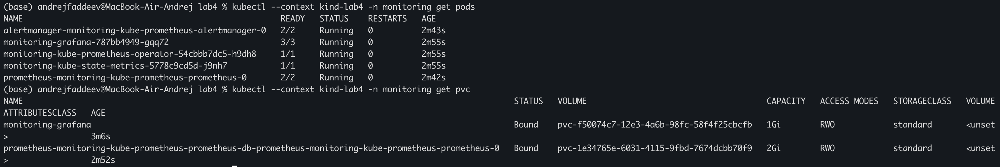

Затем, в Helm chart shop был включён мониторинг. После обновления релиза были созданы объекты ServiceMonitor для API и worker.

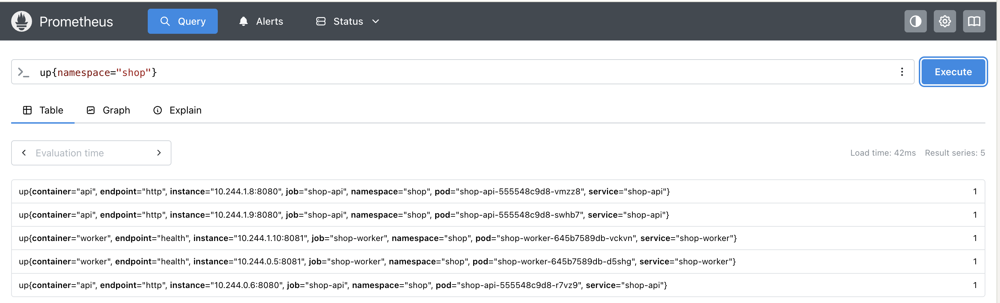

Перед сбором данных под нагрузкой была проверена доступность метрик потребления ресурсов. В Prometheus были получены значения используемой памяти и средней загрузки CPU для контейнеров API, worker, batch и PostgreSQL. Эти данные необходимы для последующего анализа ресурсов с помощью krr.

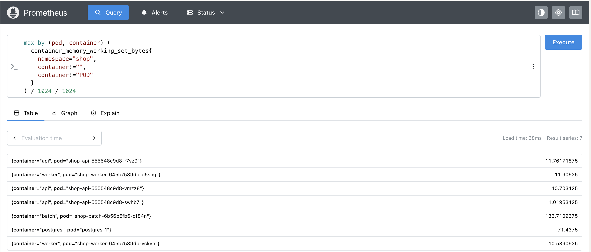

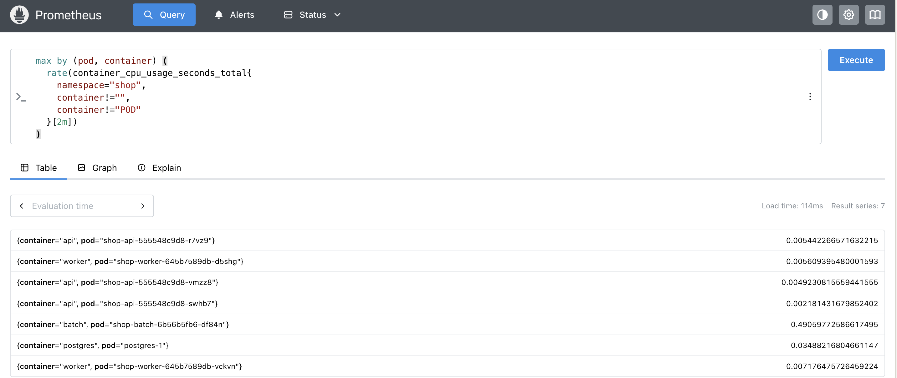

Для накопления метрик потребления ресурсов был выполнен 15-минутный нагрузочный тест создания заказов. Целевая интенсивность составляла 30 запросов в секунду с распределением между тремя репликами API. Во время тестирования Prometheus собирал метрики контейнеров. Исходные настройки ресурсов и сводка нагрузочного теста были сохранены для последующего сравнения.

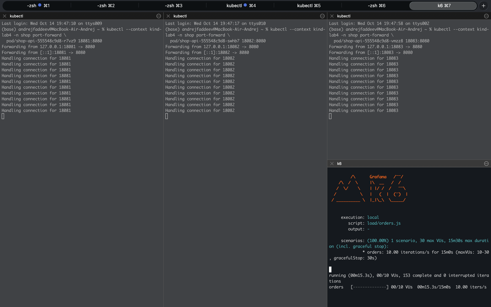

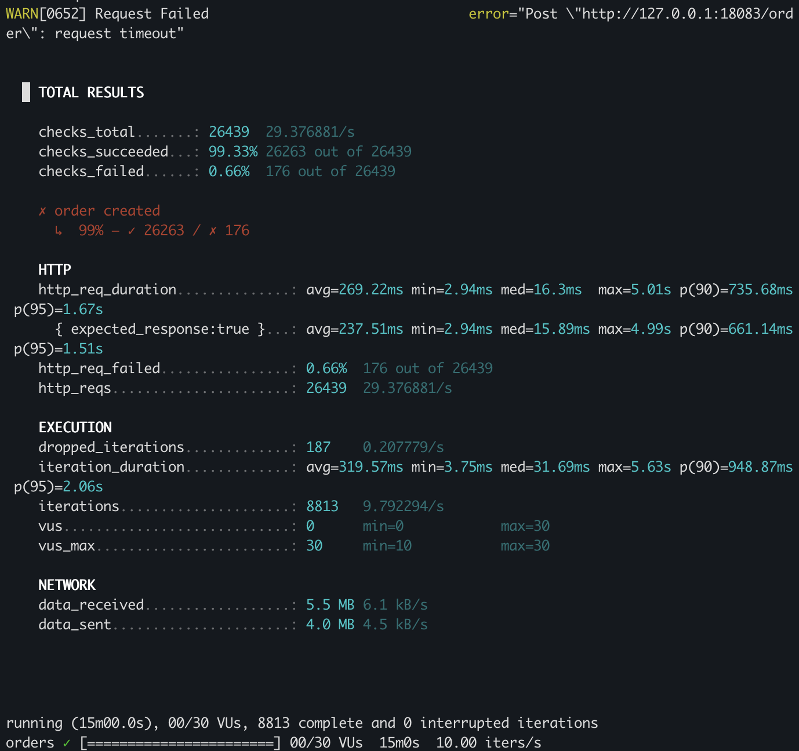

## Заключение


