# Отчёт по лабораторной работе № 5

## Часть 0. Выбор CNI

`Calico` - классический вариант CNI, который надёжно применяет сетевые политики. `Cilium` тоже применяет политики, но дополнительно даёт Hubble для наблюдения за потоками и поддерживает правила уровня приложения.

Я выбрал Cilium, исходя в основном из наличия Hubble.

## Часть 1. Сеть Pod

Кластер kind я создал без стандартного CNI, а затем установил Cilium. До готовности сетевого плагина узлы были `NotReady`; после установки оба перешли в `Ready`.

Сначала я проверил, как Pod получает адрес и как устроен путь до соседнего Pod’а.

В одном из снимков API Pod имел адрес `10.0.0.67` на `lab5-worker`. Через Cilium endpoint я посмотрел интерфейс Pod `eth0` и нашёл парный интерфейс на узле - `lxcf64137abafc9` (ifindex 43; внутри Pod он виден как `eth0@if42`). Эти интерфейсы образуют veth-пару. Один конец находится в сетевом пространстве Pod, второй - в пространстве узла.

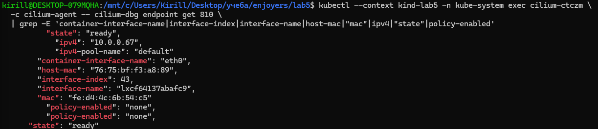
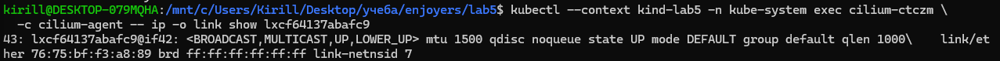

Затем я проверил межузловую связность. Из `postgres-1` на worker установил TCP-соединение напрямую к API Pod на control-plane и получил `TCP_CONNECTED`. Эта проверка показывает именно достижимость IP Pod’а через сеть кластера.

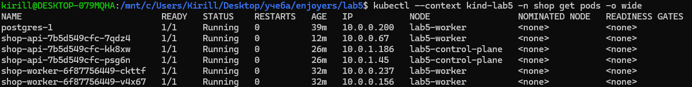
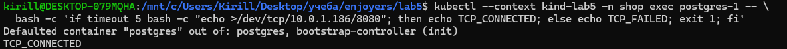

## Часть 2. Устойчивость при удалении Pod

API я опубликовал через NodePort `30080`, проброшенный kind на `127.0.0.1:30080`. Проверочный POST на `/order` вернул `HTTP 201 Created`.

NodePort здесь удобен как простая внешняя точка входа в локальный kind-кластер. `LoadBalancer` потребовал бы внешний балансировщик, которого в этом стенде нет. У Headless Service нет ClusterIP. DNS возвращает адреса Pod’ов вместо единой виртуальной точки входа.

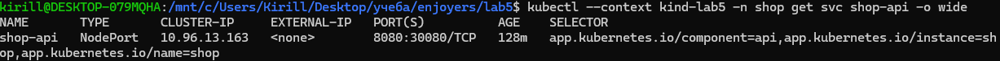
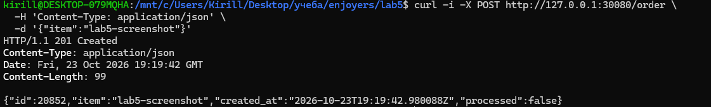

Для проверки поведения при пересоздании реплик клиент обращался к Service по DNS-имени, а не к IP отдельного Pod’а. Скрипт хаоса, приложеный в [файле](./scripts/chaos-del.sh), удалял готовые Pod’ы API или worker с интервалом 8 секунд. С помощью [скрипта](./scripts/load-client.sh) было отправлено 206 запросов. Все получили HTTP 201.

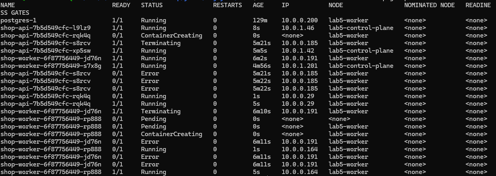

График подтверждает, что клиент пережил зафиксированные удаления Pod’ов без неуспешных запросов.

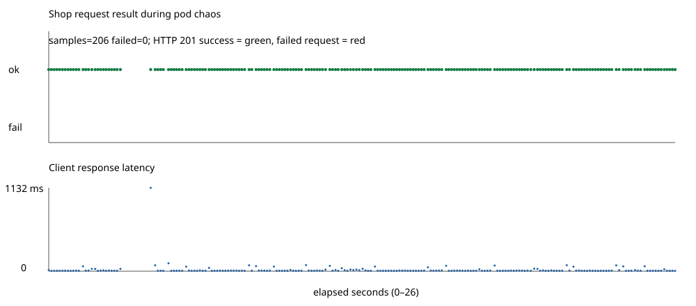

Такой результат объясняется разделением ролей в сетевом стеке. Клиент обращается к стабильному имени Service. DNS разрешает это имя, EndpointSlice отражает актуальные готовые Pod’ы, а kube-proxy в режиме `iptables` обновляет правила направления трафика на доступные endpoints.

## Часть 3. Целевая матрица доступа

Перед включением политик я определил, какие соединения нужны приложению. Клиенту требуется API, API и worker должны обращаться к PostgreSQL, а DNS нужен всем ролям, которым приходится находить Service по имени. Прямой доступ к worker и базе со стороны клиента не нужен; постороннему Pod’у не требуется доступ ни к одному компоненту приложения.

| Источник | API | Worker  | PostgreSQL  | DNS  |
|---|---|---|---|---|
| `client` | разрешено | запрещено | запрещено | разрешено |
| `api` | запрещено | запрещено | разрешено | разрешено |
| `worker` | запрещено | запрещено | разрешено | разрешено |
| `probe` | запрещено | запрещено | запрещено | разрешено |

## Часть 4. NetworkPolicy в Helm

Политики оформлены как шаблоны Helm-чарта, чтобы правила применялись вместе с приложением и настраивались через `values.yaml`. В `charts/shop/templates/networkpolicy.yaml` заданы default-deny и точечные разрешения для DNS, API, клиента, worker и PostgreSQL.

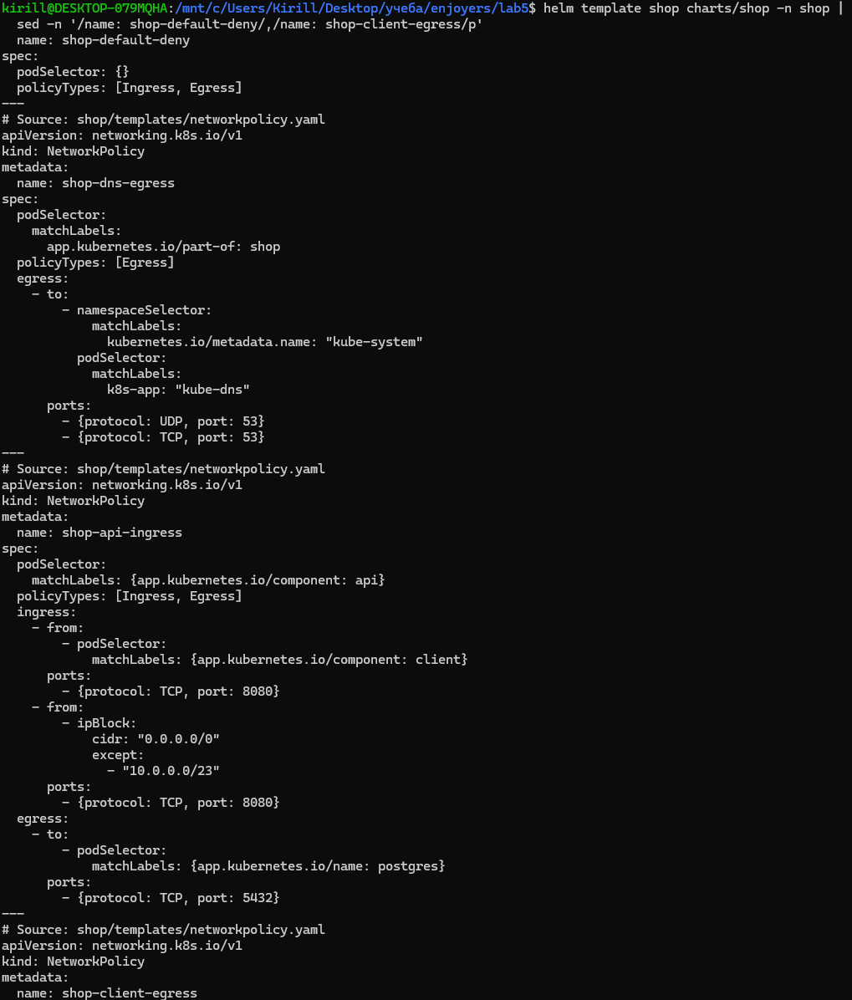
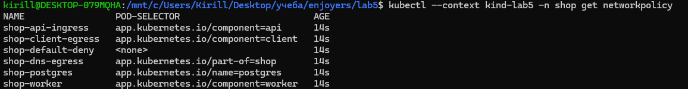

После перезапуска с применёнными сетевыми политиками Pod базы данных не стартовал. Для решения этой проблемы был создан отдельный шаблон `ciliumnetworkpolicy-postgres-apiserver.yaml`. Он разрешает PostgreSQL исходящее соединение к entity `kube-apiserver` по TCP 6443. Это backend-порт apiserver за Kubernetes Service, который нужен instance manager CloudNativePG для обращения к Kubernetes API.

## Часть 5. Практическая проверка матрицы

Целевая матрица сама по себе ещё не доказывает, что selectors и порты в NetworkPolicy настроены правильно. Поэтому я проверил разрешённые и запрещённые направления из Pod’ов с разными ролями. [Скрипт](./scripts/matrix-network-police.sh) создаёт временные тестовые Pod’ы `client`, `api`, `worker` и `probe`, используя уже загруженный в кластер образ PostgreSQL. Из каждого источника проверяются DNS и TCP-доступ к Service, затем фактический результат сравнивается с ожидаемым.

Табличку решил оформить в консоли

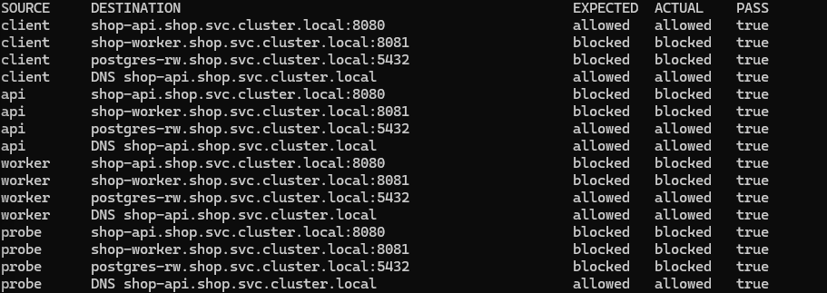

Клиент может подключиться к API, API и worker - к PostgreSQL; направления, которые по матрице должны быть закрыты, действительно блокируются. DNS-имя API Service разрешилось для всех четырёх ролей. В частности, `probe` не подключается к PostgreSQL, тогда как прикладные роли `api` и `worker` подключаются.

## Часть 6. Диагностика скрытой поломки

Для проверки диагностики я использовал [скрипт](./scripts/inject-fault.sh), который случайно выбирает один из четырёх дефектов значений чарта и применяет его через Helm. После инъекции запустил матрицу.

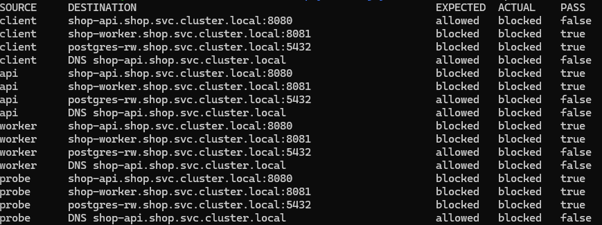

Матрица показала семь расхождений. Заблокировались client → API, api/worker → PostgreSQL и DNS для всех четырёх ролей. Запрещённые направления остались заблокированными. По симптомам стало понятно, что проблема затронула сразу несколько разрешённых потоков, но одной матрицы было недостаточно, чтобы назвать конкретную причину.

Я запустил Hubble на dropped-события и повторил проверки. В выводе появились UDP/53-пакеты от тестовых Pod’ов `lab5-matrix-client`, `lab5-matrix-api`, `lab5-matrix-worker` и `lab5-matrix-probe` к CoreDNS с вердиктами `EGRESS DENIED` и `Policy denied DROPPED`.

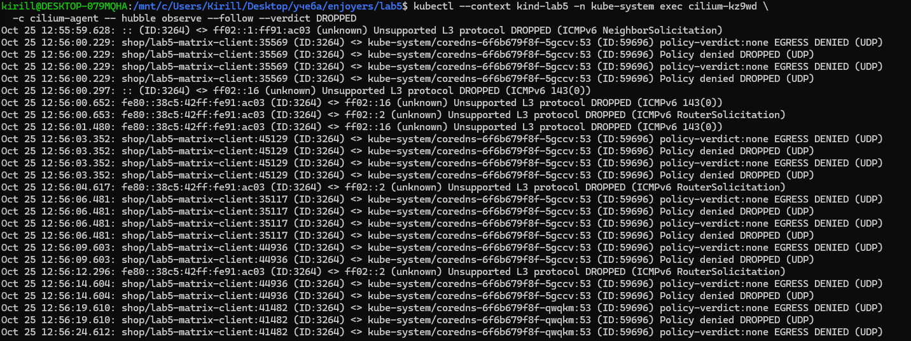

Затем я проверил применённую `shop-dns-egress` и увидел selector `k8s-app: wrong-dns-label`. У CoreDNS фактическая метка - `k8s-app=kube-dns`, поэтому selector не находил DNS Pod’ы. В результате разрешение UDP/TCP 53 не соответствовало реальным endpoints, а тестовые Pod’ы не могли разрешить имена Service. Это объясняет, почему сразу несколько TCP-проверок выглядели как отказ сети.

Для исправления я вернул базовые значения `charts/shop/values.yaml` и восстановил selector `k8s-app=kube-dns`. После этого контрольная матрица прошла все проверки.

Отдельно при восстановлении стенда после перезапуска кластера возникала проблема с доступом PostgreSQL к Kubernetes API и рассинхронизацией IP-кэша Cilium. Для API в CiliumNetworkPolicy был указан backend-порт 6443, затем выполнен rolling restart Cilium DaemonSet. После этого DNS и базовая матрица восстановились.

## Часть 7. Мониторинг

`ServiceMonitor` собирал `/metrics` всех трёх API Pod’ов. Hubble собирал `drop` и `tcp`; в Prometheus были `UP` обе цели Hubble, обе цели CoreDNS и все три API-цели. Для этой установки метка `job` CoreDNS оказалась `coredns`, поэтому это значение используется в правилах и переменной дашборда. Дашборд хранится в [JSON](charts/shop/files/network-dashboard.json) и публикуется sidecar через ConfigMap. На нём видны DNS-ответы, Hubble SYN и denied-события, HTTP-запросы API и p95 задержки. SYN - события попытки установить TCP-соединение, а не число одновременно открытых соединений.

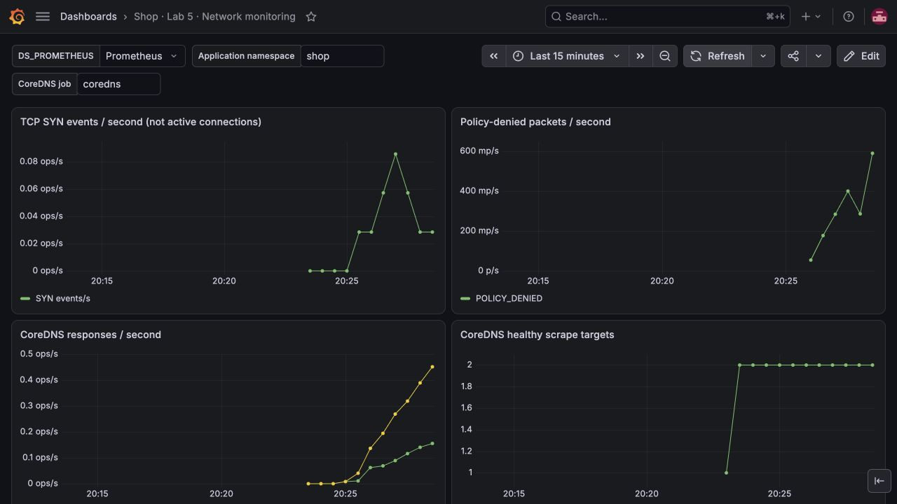

При запуске CloudNativePG оператор не мог читать status endpoint PostgreSQL на TCP 8000. Действующая политика разрешала приложению порт 5432, но не management-порт. В NetworkPolicy добавлено отдельное правило от namespace `cnpg-system` к PostgreSQL Pod’ам на TCP 8000. После применения кластер БД перешёл в `healthy`. Точечное правило оставляет прикладной доступ к PostgreSQL на 5432.

После включения monitoring ingress матрица сетевых проверок прошла без расхождений. Разрешёнными остались client - API, api/worker - PostgreSQL и DNS для всех ролей; остальные направления блокировались. Проверочные HTTP-запросы вернули `200` для `/health`, `201` для POST `/order` и `200` для `/metrics`. Затем 20-секундная нагрузка из Pod’а роли `client` создала 171 заказ. Все ответы были `201`, ошибок не было.

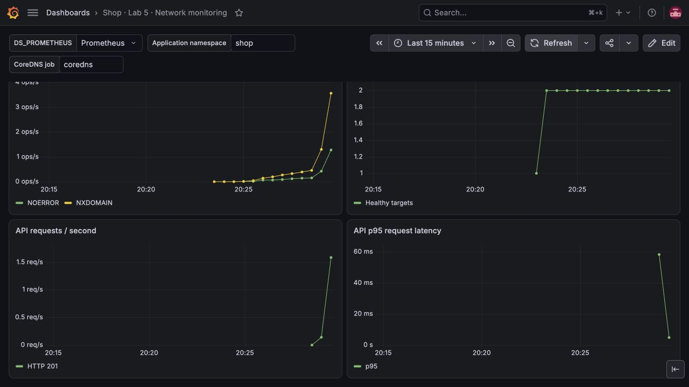

Prometheus загрузил правила `ShopAPIMetricsUnavailable`, `ShopPolicyDenied` и `ShopDNSUnhealthy`. До нарушения scrape API и DNS-алерт были `inactive`; после отрицательных направлений матрицы `ShopPolicyDenied` перешёл в `firing`, что соответствует его условию.

Сценарий [trigger-monitoring-alert.sh](scripts/trigger-monitoring-alert.sh) изменил только scrape path `ServiceMonitor/shop-api`. Путь был заменён на `/deliberately-missing-metrics`; Prometheus получил HTTP 404 от всех трёх API targets. После выдержки условия алерт `ShopAPIMetricsUnavailable` перешёл в `firing`; остальные два правила были `inactive`.

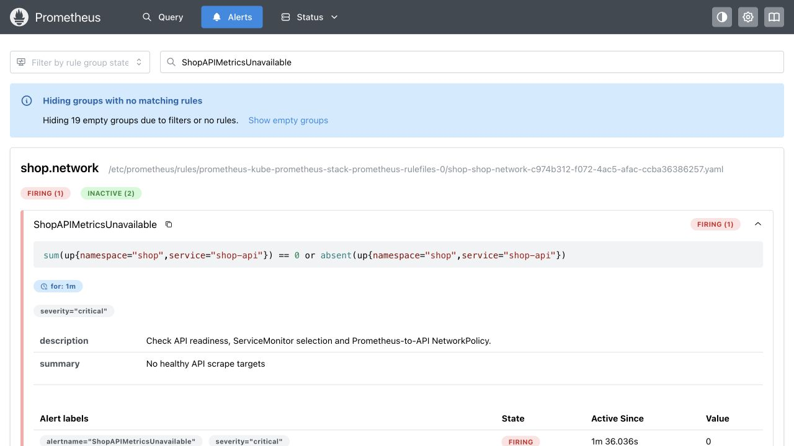

После автоматического восстановления `/metrics` Prometheus обновил конфигурацию. Все три API targets вернулись в состояние `UP`, а `ShopAPIMetricsUnavailable` стал `inactive`. Запрос firing-серии `ALERTS` не вернул результатов.

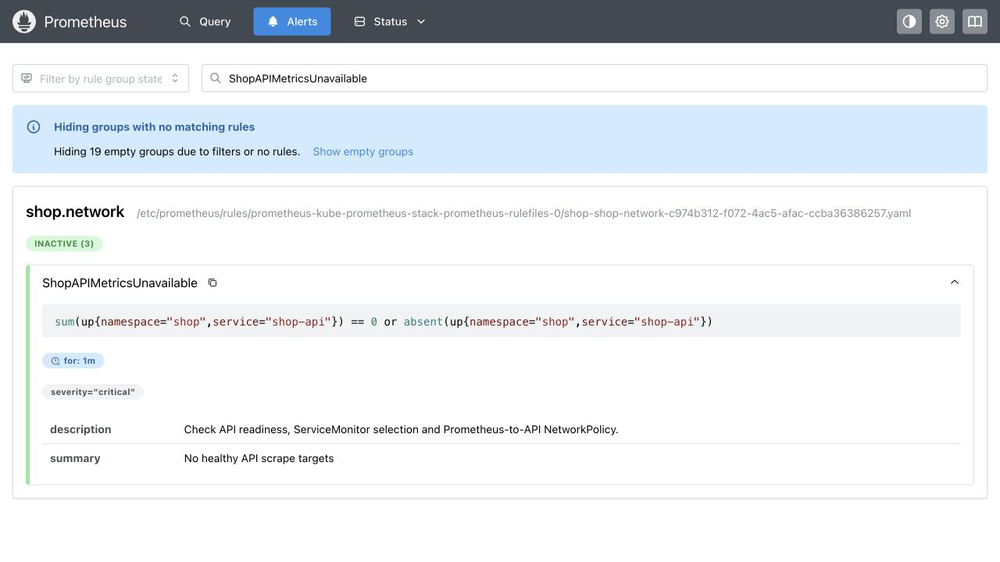

## Заключение

В работе настроены Cilium и сетевые политики приложения. Проверки подтвердили межузловую связность и соответствие доступа заданной матрице. При удалении Pod’ов API и worker все 206 запросов завершились успешно. С помощью Hubble найдена и исправлена ошибка DNS-selector. В Prometheus и Grafana проверены сбор метрик, срабатывание алерта и его снятие после восстановления.
