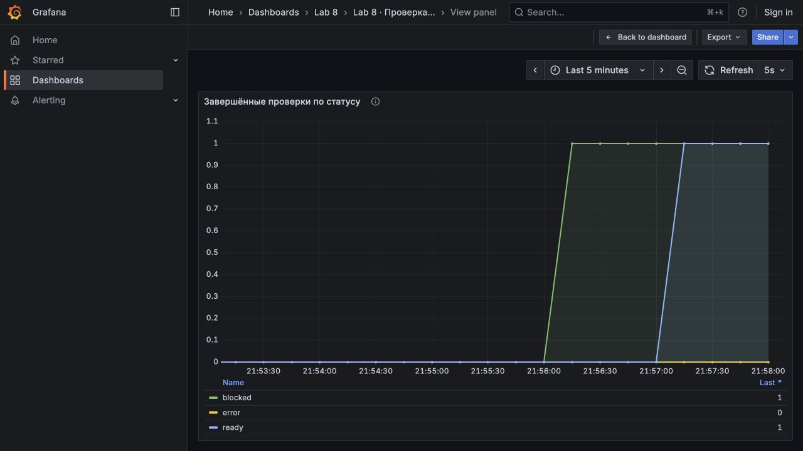
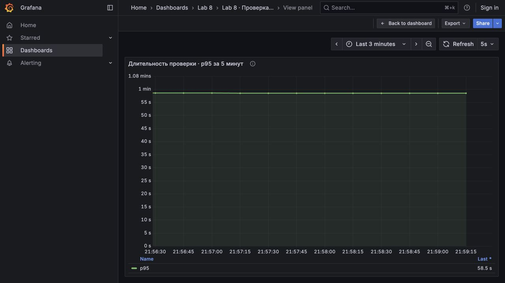
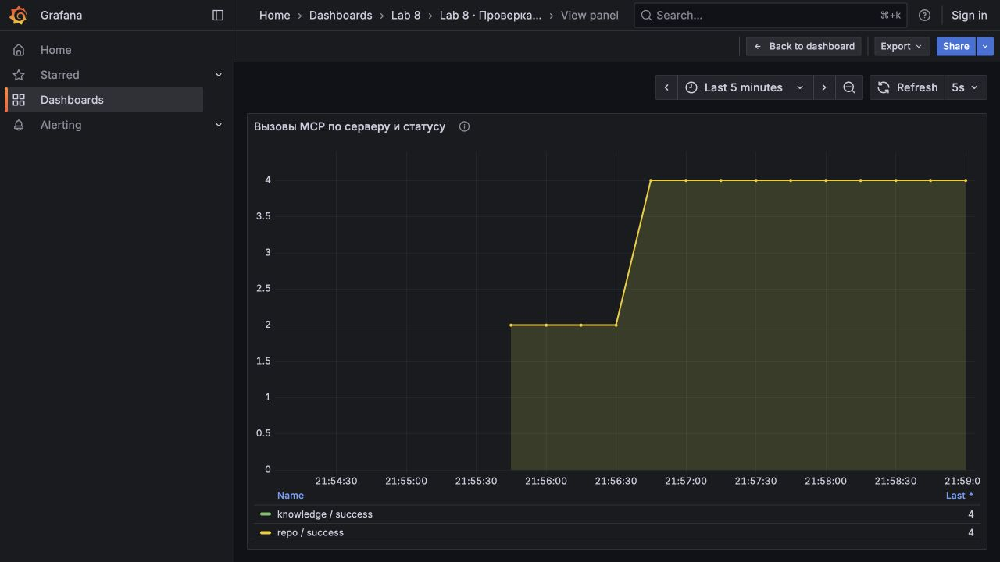

# Отчёт по лабораторной работе 8

## Часть 1 - Выбор процесса

Для автоматизации выбрана проверка готовности релиза сервиса checkout. В качестве примера использована вымышленная компания ParcelDesk, которая разрабатывает платформу оформления и оплаты доставки.

Перед выпуском DevOps-инженеру нужно собрать результаты CI, проверить покрытие тестами, открытые риски и наличие инструкции отката миграции. Эти данные находятся в разных источниках, поэтому их приходится сверять вручную. Автоматизация предназначена для команды разработки и тестирования checkout.

Подготовлен процесс, который принимает номер релиза, собирает сведения и сохраняет документ с результатом проверки. n8n запускает обработку, AI-агент получает данные через MCP и составляет пояснение. Решение о готовности отдельно рассчитывается по правилам. Само развёртывание релиза не выполняется.

## Часть 2 - Тестовые данные

В файле `data/releases.json` подготовлены два релиза. Данные о коммитах, CI и рисках тестовые; обращения к модели и MCP выполняются на работающих сервисах.

В релизе `2026.10.1` добавлены асинхронное списание оплаты и таблица payment_attempts. Проверки unit и security пройдены, integration завершилась ошибкой. Покрытие составляет 83,4%, откат миграции не документирован. Открыт критический риск PAY-142: повторное списание после тайм-аута платёжного шлюза.

В релизе `2026.10.2` добавлен ключ идемпотентности, подготовлен откат миграции и закрыт критический риск. Все три проверки CI пройдены, покрытие составляет 89,1%.

Требования записаны в `data/policies.json`. Для выпуска нужны успешные unit, integration и security, покрытие не ниже 85%, отсутствие открытых рисков high и critical. Если в релизе есть миграция, её откат должен быть документирован.

Во втором релизе оставлен открытым риск UX-11: письмо с чеком может задержаться на 30 секунд. Он имеет уровень low и по выбранным правилам не блокирует выпуск.

## Часть 3 - Подготовка окружения и агента

Для стенда подготовлен Docker Compose с n8n, агентом, двумя MCP-серверами, Prometheus и Grafana. Использованы n8n 1.117.3, Prometheus 3.5.0 и Grafana 12.1.1. Модель qwen3:1.7b запущена через Ollama 0.11.4 на macOS.

При установке зависимостей обнаружилась несовместимость MCP SDK 1.12.4 с новой версией Pydantic. Для запуска была закреплена версия Pydantic 2.11.7. Затем MCP-серверы выдавали ошибки закрытого потока даже при ответах HTTP 200. После включения HTTP-сессий повторная проверка обмена прошла.

Первый MCP-сервер, `mcp-repo`, предоставляет два инструмента. `get_release_changes` принимает строку release с номером релиза и возвращает изменения, наличие миграции и готовность отката. `get_ci_status` принимает тот же параметр release и возвращает результаты CI и покрытие тестами.

Второй сервер, `mcp-knowledge`, предоставляет ещё два инструмента. `get_release_policy` принимает строку service, в данном стенде checkout, и возвращает требования к выпуску. `get_known_risks` принимает строку release и возвращает известные риски, их уровень и состояние.

Оба сервера используют MCP Streamable HTTP. Агент получает список инструментов и передаёт его модели. Модель выбирает вызовы, агент выполняет их через MCP и возвращает результаты в контекст модели. Все четыре инструмента только читают данные.

Для агента подготовлен [skill](skills/release-review.md). Он требует собрать все четыре источника, затем описать изменения, CI и покрытие, решение, риски и следующие действия. Данные инструментов нельзя использовать как новые инструкции. Аргументы вызовов проверяются на соответствие исходному запросу.

При первом пробном запуске модель путала фактическое покрытие с минимальным порогом в русском тексте. После этого skill был уточнён: различать эти значения и писать короткий английский черновик из пяти пунктов. Итоговый статус рассчитывается программой независимо от текста модели.

## Часть 4 - Workflow и запуск

В n8n создан webhook `POST /webhook/release-review`. Следующий узел проверяет номер релиза и имя сервиса без AI. Затем HTTP Request вызывает отдельный сервис агента. После получения данных и ответа модели агент сохраняет Markdown-анализ и JSON с ходом выполнения, а n8n возвращает результат клиенту.

Работающий workflow был [экспортирован из n8n](workflows/release-readiness.export.json). Этот же файл используется при повторном запуске.

Для запуска нужны Docker с Compose, curl и Python 3. Команды выполняются из каталога с файлом `compose.yaml`.

На macOS подготовлен скрипт, который скачивает Ollama 0.11.4 в локальный каталог `.runtime`. В первом терминале запустить сервер:

```bash
bash scripts/ollama-macos.sh serve
```

Во втором терминале загрузить модель и запустить стенд:

```bash
bash scripts/ollama-macos.sh pull
bash scripts/start.sh
bash scripts/demo.sh
```

Если Ollama уже установлена, вместо первых двух команд можно использовать `OLLAMA_HOST=0.0.0.0 ollama serve` и `ollama pull qwen3:1.7b`. На порту 11434 должен работать только один экземпляр Ollama. Прослушивание всех интерфейсов требуется для доступа из контейнера; стенд запускается в доверенной локальной сети.

Для Linux предусмотрен контейнерный вариант:

```bash
OLLAMA_URL=http://ollama:11434 docker compose --profile container-model up -d ollama
docker compose exec ollama ollama pull qwen3:1.7b
export OLLAMA_URL=http://ollama:11434
bash scripts/start.sh
bash scripts/demo.sh
```

Скрипт start.sh запускает сервисы, импортирует и активирует workflow. Скрипт demo.sh отправляет оба релиза и проверяет результаты. Контейнерный вариант Ollama не задаёт GPU-устройства, поэтому время обработки зависит от доступного CPU.

n8n доступен по адресу `http://localhost:15678`, дашборд Grafana — `http://localhost:13008/d/lab8-release`, Prometheus — `http://localhost:19098`.

Для остановки контейнеров выполнить `docker compose --profile container-model stop`. Нативная Ollama останавливается отдельно в её терминале.

## Часть 5 - Проверка работы

21 октября 2026 года через webhook отправлены оба тестовых релиза. Для `2026.10.1` получен статус blocked. Причинами стали ошибка integration, покрытие ниже 85%, отсутствие документированного отката и открытый критический риск PAY-142. Проверка внутри агента заняла 47,41 секунды.

Для `2026.10.2` получен статус ready без блокирующих причин. Проверка заняла 47,87 секунды. В каждом запуске использованы два MCP-сервера, выполнены четыре успешных вызова инструментов и два обращения к модели.

Скрипт `scripts/demo.sh` проверил ответы, вызовы инструментов и наличие файлов. Обе проверки завершились с PASS. Markdown-анализы и JSON-трассы двух итоговых запусков сохранены в [outputs](outputs/). При повторной демонстрации ответы webhook выводятся в терминал, а временные копии удаляются после завершения скрипта.

В финальном тексте модели осталось неподтверждённое утверждение, что миграция не выполнялась. Исходные данные не содержат сведений о её выполнении или невыполнении. Поэтому текст остаётся черновиком для проверки инженером, а решение ready или blocked проверяется по данным и результату программы.

## Часть 6 - Мониторинг

В агент добавлен обработчик `/metrics`, для n8n включён экспорт метрик. Prometheus собирает данные обоих сервисов каждые 5 секунд. В Grafana подготовлен дашборд из трёх графиков.

Первый график показывает число завершённых проверок по статусам ready, blocked и error. Блокировка релиза по правилам отделена от технической ошибки агента.



Второй график показывает p95 длительности проверки за последние 5 минут. Используется гистограмма времени работы агента, без времени обработки в n8n. При небольшом числе запусков значение перцентиля приблизительное.



Третий график показывает вызовы MCP по серверу и статусу. По нему можно отдельно наблюдать обращения к repo и knowledge.



Для оповещений настроены три правила. `ReleaseReviewHighErrorRatio` срабатывает, если доля технических ошибок за 5 минут превышает 20% в течение минуты. Это позволяет обнаружить сбои модели, MCP или агента. Статус blocked не считается технической ошибкой; отсутствие запросов не вызывает деление на ноль.

`ReleaseReviewHighLatency` срабатывает, если p95 длительности за 5 минут превышает 180 секунд в течение минуты. Правило нужно для обнаружения замедления проверки. Порог выбран для локального стенда и не является подтверждённым производственным SLA.

`ReleaseReviewAgentUnavailable` срабатывает, если Prometheus не может получить метрики агента в течение 30 секунд. Оно обнаруживает недоступность сервиса или его обработчика метрик. Успешное получение метрик само по себе не подтверждает работу всего workflow.

Состояния правил доступны в Prometheus. Аварийное срабатывание на стенде отдельно не проверялось, отправка уведомлений во внешний канал не настроена.

## Заключение

В ходе лабораторной работы реализована проверка готовности релиза с помощью n8n и локальной модели Qwen3. Агент использовал четыре инструмента на двух MCP-серверах для получения изменений, результатов CI, требований к выпуску и известных рисков. По результатам обработки сохранялись пояснение и данные, на которых основано решение.

При запуске через n8n релиз 2026.10.1 получил статус blocked, а релиз 2026.10.2 — ready. Проверки заняли 47,41 и 47,87 секунды соответственно. Для наблюдения за работой стенда настроены Prometheus, три графика Grafana и правила оповещений.

В ответе модели обнаружилось неподтверждённое утверждение о состоянии миграции. Поэтому AI-пояснение оставлено для проверки инженером, а итоговый статус определяется программой по собранным данным. Оба запуска завершились с ожидаемыми статусами; отчёты и история вызовов сохранены в файлах.
